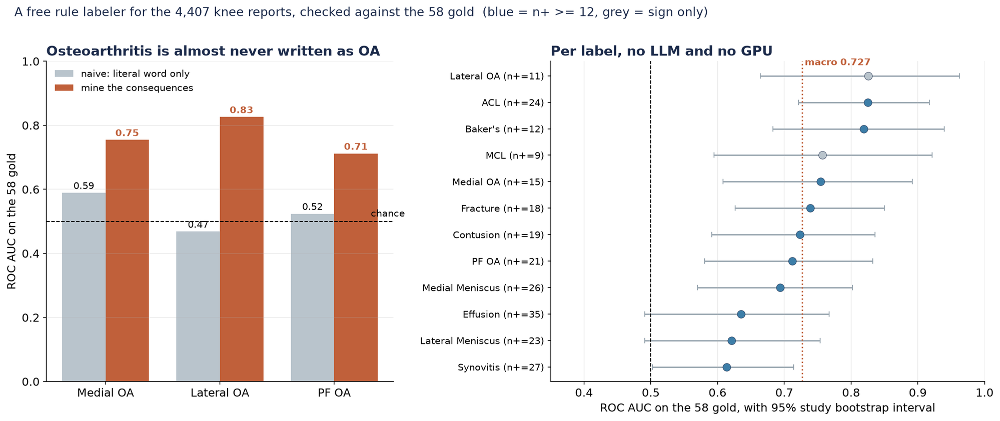

# Labeling the 4,349 report-only studies without an LLM, and what it scores on the 58 gold

- **URL:** https://www.kaggle.com/competitions/rsna-knee-abnormality-detection/discussion/734095
- **Author:** **Akmal Xodarev (Busya PRIME)** (@busyaprime, Expert) · _topic author_ · 2026-08-09 20:31 UTC · LB rank 3238
- **Topic votes:** 0 · **Comments/replies:** 0 · **Pinned:** no
- **Last comment:** 2026-08-09 20:31 UTC by Akmal Xodarev (Busya PRIME)
- **Cloned:** 2026-10-01 19:24 UTC (topic id 734095, raw JSON `_raw/734095.json`)

---

The host confirmed that sending report text to a hosted LLM is allowed, with the caveat that the tool has to be reasonably accessible to everyone and of minimal cost. That caveat is the reason I went the other way and wrote a labeler that uses no API, no model weights and no GPU, so it runs inside the competition notebook for free and there is nothing to gate access on. Posting what it does and what it scores, since a transparent zero-cost baseline seems worth having on the record next to the LLM approaches.

Left: the two osteoarthritis compartments go from no signal to strong once you read the consequences instead of the word. Right: all 12 labels on the 58 gold with 95% bootstrap intervals, macro 0.727, no LLM and no GPU.

The setup, for anyone who has not counted rows yet: train.csv has 4,407 studies but only 58 carry the 12 labels. The other 4,349 have a radiology report and nothing else, so the report is a train-only teacher. test.csv is study ids only, so whatever labels you derive, the model that actually scores has to read pixels.

The labeler is a rule system, not a model. It reads each report in its own language (a crude detector finds at least eight, and reading them I hit English, Spanish, German, Dutch, French, plus Greek and Turkish), fires a per-finding vocabulary, and runs a negation and uncertainty check on every mention so that "no meniscal tear", "sin rotura", "geen scheur" and "kein" count as negative instead of positive. Then it maps the surviving mentions onto the 12 targets.

Two things mattered more than I expected, both measured on the 58 gold:

1. Osteoarthritis is almost never written as the word osteoarthritis. Under naive reading Lateral OA is 0.47 (below chance) and Medial OA is 0.59, essentially no usable signal. They only come alive once you mine the consequences the radiologist actually writes: osteophytes, joint space narrowing, chondral loss, chondrosis, gonarthrose, with the compartment word next to them, plus the rule that "tricompartmental" fires all three OA labels. That vocabulary takes Lateral OA to 0.83 and Medial OA to 0.75. Because the metric is the mean of 12 AUCs, resurrecting two dead labels was the single biggest lever I found.

2. Negation is a real cleanup but a smaller one on the macro. The ablation, macro AUC over the 12 on the 58 gold: naive keyword presence 0.638, add sentence-scope negation 0.667, add the OA consequence vocabulary 0.727. Negation mostly buys precision (fracture precision 0.53 to 0.80, Baker's 0.42 to 0.62) rather than ranking.

Per label the labeler runs from Synovitis 0.61 (the hardest, since on non-contrast MRI it cannot be cleanly separated from a simple effusion) and Effusion 0.63 (only that, despite being the most common finding and the co-occurrence hub) up to ACL and Lateral OA at 0.83. Macro is 0.727 with a study-level bootstrap interval of roughly 0.67 to 0.78. MCL has only 9 positives in the 58, so read its number as a sign, not a measurement.

Honest limits. The vocabulary was refined by reading the 58 gold reports and there is no second labeled set, so 0.727 is an in-sample number and probably optimistic. A good local or hosted LLM will likely beat this on the subtle classes. What the rule labeler gives you instead is that it is free, deterministic, auditable line by line, and never leaves the notebook, so the silver labels it emits are reproducible rather than a black box.

Full method, the ablation, the per-label intervals and the multilingual DICOM figures are in the notebook, and it writes silver_labels.csv for all 4,349 report-only studies as its output, so you can fork it and train an images-only model on it directly:
https://www.kaggle.com/code/busyaprime/osteoarthritis-is-almost-never-written-as-oa

Happy to fold in more finding vocabulary if people paste phrasings they are seeing in languages I undercovered.

---

## Comments (0, threaded, oldest first)

_No comments._
