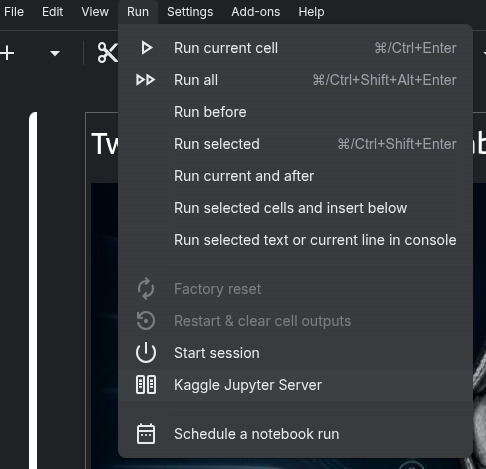

# comple and run successfully but output submsson.csv not found error

- **URL:** https://www.kaggle.com/competitions/rsna-knee-abnormality-detection/discussion/734676
- **Author:** **Chandru** (@tamiltechno, Contributor) · _topic author_ · 2026-08-12 11:13 UTC
- **Topic votes:** 0 · **Comments/replies:** 5 · **Pinned:** no
- **Last comment:** 2026-08-25 15:58 UTC by Chandru
- **Cloned:** 2026-10-01 19:24 UTC (topic id 734676, raw JSON `_raw/734676.json`)

---

h all 
comple and run successfully but output submsson.csv not found error

---

## Comments (5, threaded, oldest first)

### [1] PC Jimmmy

**PC Jimmmy** (@pcjimmmy, Master) · 2026-08-12 16:19 UTC · LB rank 642

This normally suggests that your code did ok on the 3 fake tests but failed before the file was written when running the full 1300 test files.

The best process is to run the predictions on the training file in the editor.  That will reveal actionable error messages.   If no success than make the notebook public along with any data sets and share a link here.  Someone will be happy to help.

#### ↳ [1.1] Chandru

**Chandru** (@tamiltechno, Contributor) · _topic author_ · 2026-08-13 06:41 UTC

thank you so much sr... made correctons as:1. Stress-test at real scale using train data (as recommended)

Run the exact same inference logic against ~1300+ studies from train_series (ignoring labels, just checking it runs end-to-end without crashing or timing out) — this surfaces errors the 3 fake test files never would.

2. Make the submission loop crash-proof

Even if one study hits an unexpected edge case (corrupted DICOM, unusual folder structure, empty series), the loop shouldn't die — it should log the failure, substitute a fallback prediction, and keep going so submission.csv always gets written with the full row count.  wll update

##### ↳ ↳ [1.1.1] PC Jimmmy

**PC Jimmmy** (@pcjimmmy, Master) · 2026-08-13 16:30 UTC · LB rank 642

If you can't get it working - I would go with my other suggestion and post a link to your notebook after you make it public - and make any datasets public.  

Would be happy to look it over and I am sure others would do the same.  I can pretty often find the issue in the code - after being here on kaggle for many years I have made almost every mistake possible.

Good luck

### [2] Enai

**Enai** (@enaimaan, Contributor) · 2026-08-25 13:37 UTC · LB rank 3044

One thing that may help you if you use coding agents (Claude Code, Codex, opencode ....)
Ask it to set up the Jupyter-mcp-server from DataLayer for you locally:

[Jupyter-mcp-server GitHub link](https://github.com/datalayer/jupyter-mcp-server)

Then from your notebook create and share the link from Run -> Kaggle server -> vscode compatible URL.

You can probably share it with your coding agent but just keep in mind that it contains your JWT token (they are ways to deal with this you just ask your Coding Agent).

this way your coding agent can autonomously debug your notebook if you want it to.

#### ↳ [2.1] Chandru

**Chandru** (@tamiltechno, Contributor) · _topic author_ · 2026-08-25 15:58 UTC

thank you so much.will try and return .
