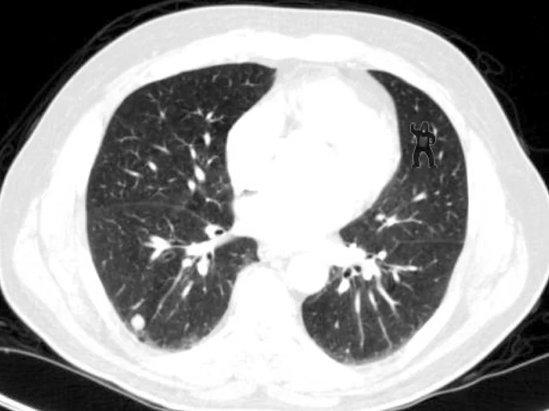

# Are you actually looking at the data?

- **URL:** https://www.kaggle.com/competitions/rsna-knee-abnormality-detection/discussion/736301
- **Author:** **Chikuwabu** (@prgckwb, Master) · _topic author_ · 2026-08-20 08:43 UTC · ▲11 · LB rank 28
- **Topic votes:** 11 · **Comments/replies:** 2 · **Pinned:** no
- **Last comment:** 2026-08-20 15:38 UTC by PC Jimmmy
- **Cloned:** 2026-10-09 09:46 UTC (topic id 736301, raw JSON `_raw/736301.json`)

---

The image above is a CT scan. This image contains a gorilla. According to this article, even highly trained radiologists often miss the gorilla.

Before blindly training models with Coding Agent, it might be a good idea to check if there is a gorilla in the knee MRI.

https://www.npr.org/sections/health-shots/2013/02/11/171409656/why-even-radiologists-can-miss-a-gorilla-hiding-in-plain-sight

---

## Comments (2, threaded, oldest first)

### [1] Tom Aindow

**Tom Aindow** (@taindow, Master) · 2026-08-20 11:31 UTC · ▲4 · LB rank 83

I already insert random images of gorillas and other primates as part of my augmentation process. I thought this was common practice?

### [2] PC Jimmmy

**PC Jimmmy** (@pcjimmmy, Master) · 2026-08-20 15:38 UTC · ▲1 · LB rank 643

I have found one of the bad parts of using LLM's to help has been a huge decline in my looking at the images.

I use to spend most of the first couple of weeks of a competition doing mostly EDA's and looking at hundreds or even thousands of the images.  This is the 2nd competition would I seem to have completely skipped that vital step.
