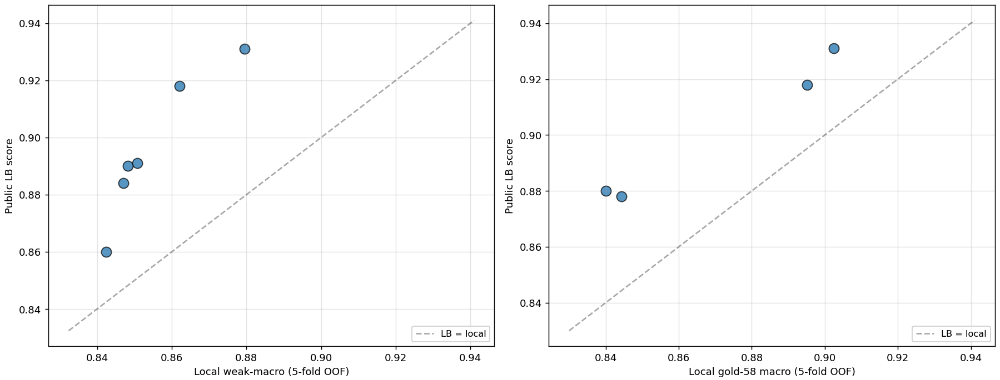
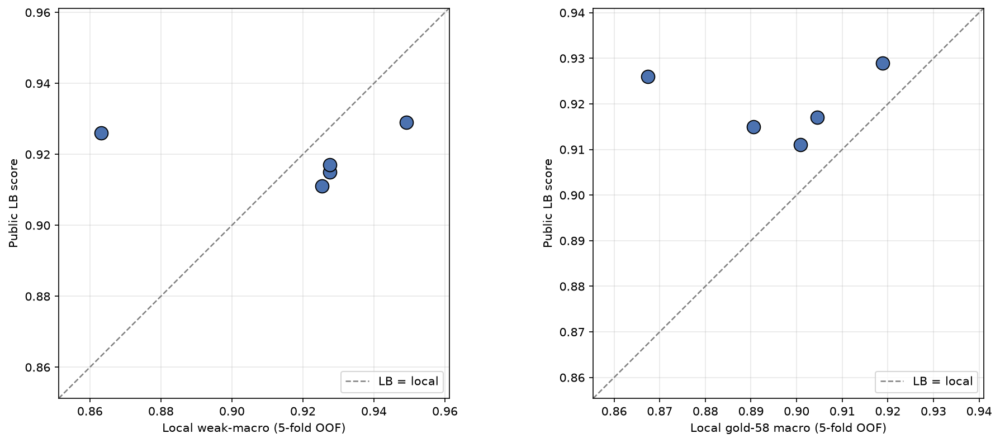
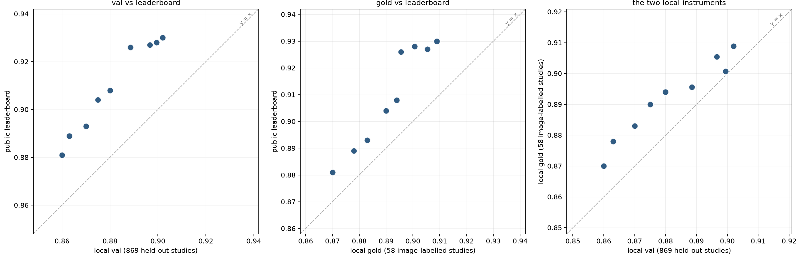
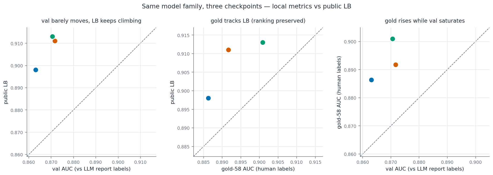

# LB OOF relationship

- **URL:** https://www.kaggle.com/competitions/rsna-knee-abnormality-detection/discussion/736635
- **Author:** **Nicolai Karcher** (@pejophylo, Contributor) · _topic author_ · 2026-08-21 21:16 UTC · ▲7 · LB rank 793
- **Topic votes:** 7 · **Comments/replies:** 3 · **Pinned:** no
- **Last comment:** 2026-08-23 13:16 UTC by Komil Parmar
- **Cloned:** 2026-10-14 18:23 UTC (topic id 736635, raw JSON `_raw/736635.json`)

---

Hi,

as in the recent ROGI wellbore challenge, I'm seeing an *underestimation* of my model performances in local OOF wrt LB (which is extra weird because I feel, if anything, I probably have local *leakage* since my folds are not that well stratified). Especially for weak macro-AUC the relationship is particularly strange (looks nonlinear)

Do other people observe the same for their models?

---

## Comments (3, threaded, oldest first)

### [1] k256.dev

**k256.dev** (@k256net, Master) · 2026-08-22 00:58 UTC · ▲4 · LB rank 1952

I'm seeing the same trend.

One of my points is an especially extreme outlier. That particular run used a CV scheme where leakage is impossible, so I have high confidence in that CV number — which suggests the public LB is simply quite a bit easier than our local validation.

As for the gold labels: with so few samples, it's only reasonable that they don't correlate. And the weak labels obviously aren't trustworthy either. So my read is that the gold set just contains a lot of hard cases. Alternatively, the gold subset alone may come from a different domain than the rest of the data — something that has come up repeatedly in other threads.

### [2] Tom Aindow

**Tom Aindow** (@taindow, Master) · 2026-08-22 07:22 UTC · ▲2 · LB rank 83

Very similar pattern for me too. For local validation I expect or even hope for it, since the labels are report-derived and contain noise and error that I don't think the image labels should. As others say for gold, it's a small sample and clearly not representative of the larger training corpus, so not surprising, though it is nice that it is at least a somewhat consistent delta over time.

### [3] Komil Parmar

**Komil Parmar** (@komilparmar, Expert) · 2026-08-23 13:16 UTC · LB rank 59

Unfortunately I only have 3 self trained models so far. What I see is gold at least for me is much more aligned with the LB, whereas val is quite noisy. Its surely because my val labels are not that accurate. 

