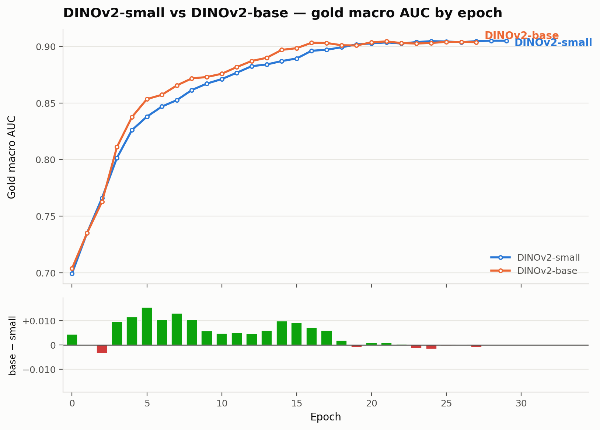

# Dinov2 Base vs Small at 224 resolution

- **URL:** https://www.kaggle.com/competitions/rsna-knee-abnormality-detection/discussion/738096
- **Author:** **Komil Parmar** (@komilparmar, Expert) · _topic author_ · 2026-08-29 14:20 UTC · ▲5 · LB rank 59
- **Topic votes:** 5 · **Comments/replies:** 2 · **Pinned:** no
- **Last comment:** 2026-08-29 15:18 UTC by Komil Parmar
- **Cloned:** 2026-10-14 18:23 UTC (topic id 738096, raw JSON `_raw/738096.json`)

---

Just wanted to share a small ablation, so you don't have to conduct the same. 

So far I had used only the small variant of DINOv2 for all my experiments, so I tried whether base gives any further improvement. Everything else about the two runs is identical, like same data, same schedule, same augmentation, same seed. Only the backbone was swapped.

Findings (gold macro AUC by epoch chart attached):

  

Base converges clearly faster: it holds a lead of up to ~+0.015 through the early and middle epochs.
However, given a long enough schedule, both curves converge to the same final score, the endpoint difference is within noise (see the green/red delta bars fading to zero).

Practical takeaway: if for some reason you are fighting against overfitting (YOU SHOULD NOT BTW) or you're compute-bound or just want training short schedules for any other reason, base reaches a given score in noticeably fewer epochs. If you train to convergence, small gets you the same result at roughly 4× less compute and it's the **obviously better choice for the efficiency prize**.

This is consistent with what was discussed in the earlier encoder-size thread, capacity doesn't seem to raise the ceiling at 224. Whatever is limiting scores at this resolution, it doesn't appear to be model size. 

Caveats: single fold, single seed, 224 px only, I haven't tested whether the same holds at higher resolutions BUT I do believe the trend will favor larger variants at larger resolution.

I know the configuration and other training details are missing, but that's intentional. :`)

---

## Comments (2, threaded, oldest first)

### [1] PC Jimmmy

**PC Jimmmy** (@pcjimmmy, Master) · 2026-08-29 15:12 UTC · ▲1 · LB rank 641

Nice share and agree with your conclusions - my current approach.  Experiment with single fold, smallest Dino, 224 image - submissions marked for efficiency.   When I think I am making some progress, 5 fold, largest model, 448 image for LB score.

#### ↳ [1.1] Komil Parmar

**Komil Parmar** (@komilparmar, Expert) · _topic author_ · 2026-08-29 15:18 UTC · ▲1 · LB rank 59

Yeah, same here. 
Stick to cheap configurations, single fold, for ablations, experiments, and then do the final run at last for heavy configuration, I will do when the competition is near end.
 
Of course some things would perform better at higher resolution, and single fold may contain some noise, but there aren't any drastic changes here. The strategy works **perfectly** for this competition. 

Meanwhile there are people arguing about compute requirements :`)
