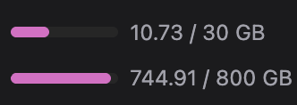

# Is the dataset for this competition really 569.76 GB?

- **URL:** https://www.kaggle.com/competitions/rsna-knee-abnormality-detection/discussion/739693
- **Author:** **Ataracsia** (@ataracsia, Contributor) · _topic author_ · 2026-09-05 14:35 UTC
- **Topic votes:** 0 · **Comments/replies:** 3 · **Pinned:** no
- **Last comment:** 2026-09-05 15:48 UTC by tennogh
- **Cloned:** 2026-10-14 18:23 UTC (topic id 739693, raw JSON `_raw/739693.json`)

---

I downloaded this .zip file and extracted it, but it only came to about 530 GB (819,640 files).

Perhaps the extraction didn’t work properly?

---

## Comments (3, threaded, oldest first)

### [1] SpeedSci

**SpeedSci** (@caoyupeng, Expert) · 2026-09-05 15:06 UTC · ▲1 · LB rank 1071

right

### [2] PC Jimmmy

**PC Jimmmy** (@pcjimmmy, Master) · 2026-09-05 15:33 UTC · ▲1 · LB rank 641

571.9 here -but I have a couple of extra text files in the folder right now for 2.0 = 569.9

### [3] tennogh

**tennogh** (@tennogh, Master) · 2026-09-05 15:48 UTC · ▲1 · LB rank 8

Probably GiB vs GB measurements.
