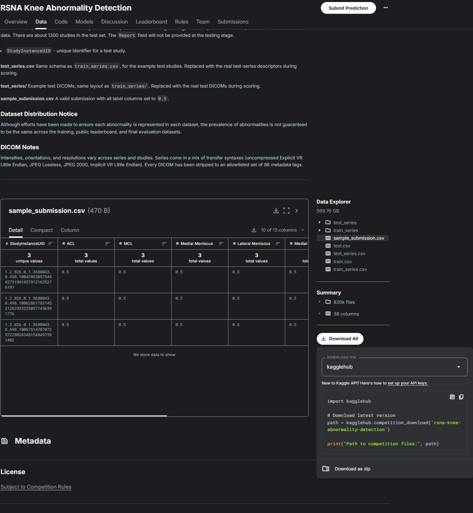

# Broken download link

- **URL:** https://www.kaggle.com/competitions/rsna-knee-abnormality-detection/discussion/741916
- **Author:** **MJ121212** (@mj121212, Contributor) · _topic author_ · 2026-09-18 12:10 UTC · ▲3 · LB rank 1552
- **Topic votes:** 3 · **Comments/replies:** 4 · **Pinned:** no
- **Last comment:** 2026-09-19 14:45 UTC
- **Cloned:** 2026-10-01 19:24 UTC (topic id 741916, raw JSON `_raw/741916.json`)

---

the download link to the dataset and several links are broken and unusable now. they were working before. I cannot download the dataset again, even with the script. I have attached the snapshot of the page I am taking about with the link.  

---

## Comments (4, threaded, oldest first)

### [1] Ryan Holbrook

**Ryan Holbrook** (@ryanholbrook, Staff) · 2026-09-18 17:50 UTC

Hi @mj121212,

Thanks for the report. We attempted to update the dataset recently to fix the corrupted DICOMs, but it looks like the update may have failed. I will look into it.

#### ↳ [1.1] CoreyJamesLevinson

**CoreyJamesLevinson** (@returnofsputnik, Grandmaster) · 2026-09-19 04:23 UTC · LB rank 2483

@ryanholbrook Which DICOMs were corrupted/replaced? Is there a discussion talking about them?

#### ↳ [1.2] (unknown)

**(unknown)** · 2026-09-19 14:45 UTC

_(no content — deleted or empty)_

### [2] Sanjib Biswas

**Sanjib Biswas** (@aidiagnosis, Contributor) · 2026-09-19 09:17 UTC · LB rank 2225

My understanding is that due to large data size (569.76 GB) / 819640 files, Kaggle prefer that we download the data using Kaggle SDK. However, if you click on the "Download as zip", it should download 246GB file.
