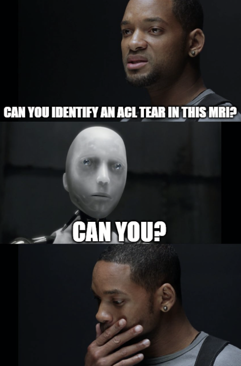
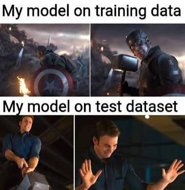

# Meme thread

- **URL:** https://www.kaggle.com/competitions/rsna-knee-abnormality-detection/discussion/742053
- **Author:** **Chikuwabu** (@prgckwb, Master) · _topic author_ · 2026-09-19 08:40 UTC · ▲11 · LB rank 64
- **Topic votes:** 11 · **Comments/replies:** 6 · **Pinned:** no
- **Last comment:** 2026-10-05 17:55 UTC by DECEM
- **Cloned:** 2026-10-09 09:46 UTC (topic id 742053, raw JSON `_raw/742053.json`)

---

---

## Comments (6, threaded, oldest first)

### [1] (unknown)

**(unknown)** · 2026-09-19 10:11 UTC

_(no content — deleted or empty)_

### [2] Chris Deotte

**Chris Deotte** (@cdeotte, Grandmaster) · 2026-09-26 00:04 UTC · ▲2 · LB rank 131

### [3] Tucker Arrants

**Tucker Arrants** (@tuckerarrants, Master) · 2026-10-02 14:50 UTC · ▲5 · LB rank 17

Me finetuning Qwen

### [4] DhawalModi

**DhawalModi** (@daveconnor, Contributor) · 2026-10-03 18:23 UTC · ▲1 · LB rank 69

### [5] OmerZalman

**OmerZalman** (@omerzalman, Contributor) · 2026-10-05 16:19 UTC · LB rank 4700

### [6] DECEM

**DECEM** (@zy1343930734, Master) · 2026-10-05 17:55 UTC · ▲1 · LB rank 2910

Old pictures, new memes 

