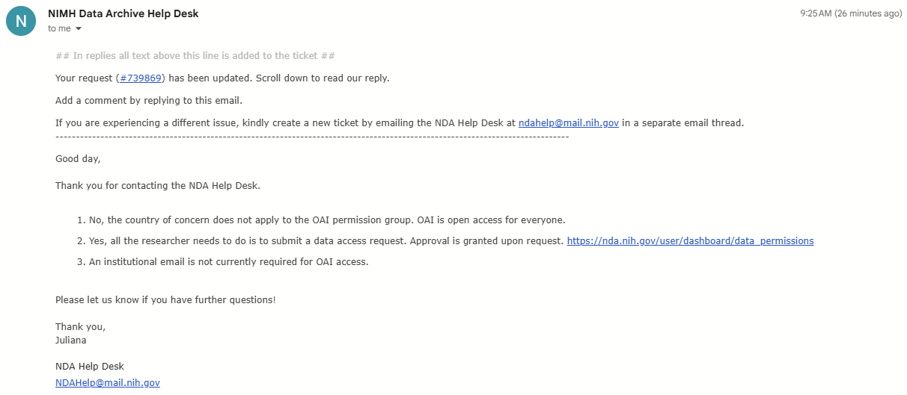

# Please clarify which external knee MRI datasets are allowed

- **URL:** https://www.kaggle.com/competitions/rsna-knee-abnormality-detection/discussion/743416
- **Author:** **YYama** (@yosukeyama, Master) · _topic author_ · 2026-09-26 01:52 UTC · ▲80 · LB rank 10
- **Topic votes:** 80 · **Comments/replies:** 27 · **Pinned:** no
- **Last comment:** 2026-10-09 08:06 UTC by Satwik
- **Cloned:** 2026-10-09 09:46 UTC (topic id 743416, raw JSON `_raw/743416.json`)

---

Thank you to the hosts for organizing this challenge and for taking the time to answer questions throughout the competition. I appreciate that assessing third-party datasets individually is difficult, especially when their access requirements and licenses differ.

Questions about external knee MRI data are spread across several threads. Without a clear answer for commonly used datasets, teams may train under different assumptions about what is permitted, which makes it difficult to ensure a level playing field.

I have read the [original question](https://www.kaggle.com/competitions/rsna-knee-abnormality-detection/discussion/733652), the [registration-gated dataset question](https://www.kaggle.com/competitions/rsna-knee-abnormality-detection/discussion/735497), and the [institutional-agreement follow-up](https://www.kaggle.com/competitions/rsna-knee-abnormality-detection/discussion/737950). There are also separate questions about [pretrained weights](https://www.kaggle.com/competitions/rsna-knee-abnormality-detection/discussion/735121) and [research-use agreements](https://www.kaggle.com/competitions/rsna-knee-abnormality-detection/discussion/738111).

The host has [explicitly ruled that KneeCoT is not allowed](https://www.kaggle.com/competitions/rsna-knee-abnormality-detection/discussion/734109) because its formal institutional agreement may create unequal access. The host has also [explained](https://www.kaggle.com/competitions/rsna-knee-abnormality-detection/discussion/733965) that non-commercial terms alone do not exclude a dataset, while straightforward registration and substantial institutional approval may be treated differently. It remains unclear to me how these principles apply to the following resources:

| Resource | Relevant access or licensing issue |
| --- | --- |
| [Stanford MRNet](https://aimi.stanford.edu/datasets/mrnet-knee-mris) | Research-use agreement |
| [Stanford SKM-TEA](https://aimi.stanford.edu/datasets/skm-tea-knee-mri) | Registration and data-use terms |
| [NYU fastMRI](https://fastmri.med.nyu.edu/) and [fastMRI+](https://github.com/microsoft/fastmri-plus) | Data-sharing agreement for images; separately released annotations |
| [Osteoarthritis Initiative (OAI)](https://nda.nih.gov/oai) | Data Use Certification and institutional requirements |
| [KneeMRI](https://zenodo.org/records/14789903) | CC BY-NC-ND 4.0 |
| [KneeXNet-2.5D](https://github.com/pitthexai/Knee_MRI_Segmentation_2.5D) | Public OAI-derived annotated images and pretrained weights; no explicit repository license that I could identify |

Could the hosts give a **yes or no for each resource** under this competition's external-data rules? If the answer differs between training on the images and fine-tuning publicly released weights, please state that separately. It would also help to know whether using each resource is compatible with the winner's requirement to release the final model. I understand that teams remain responsible for complying with the original providers' terms.

Because the same question keeps appearing in different threads, could the hosts **pin the answer in the Discussion** so all teams can find and follow the same guidance?

@javaduke95

---

## Comments (27, threaded, oldest first)

### [1] Tucker Arrants

**Tucker Arrants** (@tuckerarrants, Master) · 2026-09-26 03:25 UTC · ▲6 · LB rank 17

This is quite pressing and could really throw off the leaderboard. I could be wrong, but it's only the winning solutions (top 10) that would be audited thoroughly enough that training on external data sources that are not allowed would even get "caught" and disqualified. Basically everyone else could probably get away with it. This is a problem as it can totally reshape the final non top 10 rankings. I think external data, even small amounts of it, can substantially increase score in this competition so the impact of this could be extreme.

#### ↳ [1.1] YYama

**YYama** (@yosukeyama, Master) · _topic author_ · 2026-09-26 05:50 UTC · ▲4 · LB rank 10

I couldn't agree more. I worry that detailed review may naturally focus on prize-eligible teams, while the effects of unclear external-data rules could extend across the entire leaderboard.

What particularly concerns me is that relevant external knee MRI data could allow even a fairly simple approach to achieve a dramatic improvement in score. If some teams use those datasets while others refrain because the rules are unclear, the competition becomes substantially unequal. I would appreciate explicit guidance from the hosts on which datasets are allowed.

### [2] Cemal Atas

**Cemal Atas** (@cemalata, Contributor) · 2026-09-27 11:19 UTC · ▲2 · LB rank 43

This is really important. I have a similar question for the hosts. Can we use publicly released pretrained models (MIT license and all) that were trained on OAI-derived data?

#### ↳ [2.1] YYama

**YYama** (@yosukeyama, Master) · _topic author_ · 2026-09-28 11:22 UTC · LB rank 10

I agree. Clear guidance on this point is important to ensure a level playing field for all participants.

### [3] madmax0404

**madmax0404** (@max6296, Expert) · 2026-09-30 08:03 UTC · ▲3 · LB rank 881

4 days and still no answer. is that a yes?

### [4] Pratham Lahoti

**Pratham Lahoti** (@prathamlahoti2, Contributor) · 2026-09-30 17:25 UTC · ▲2 · LB rank 1230

++ This is really important, please provide clarification

### [5] Ali Ozan Memetoglu

**Ali Ozan Memetoglu** (@aliozanmemetoglu, Expert) · 2026-09-30 19:08 UTC · ▲2 · LB rank 851

MRNet’s user agreement says we’re not allowed to modify, reverse engineer, decompile, or create derivative works from the dataset, so that might be an issue too.

### [6] Eugene Khvedchenya

**Eugene Khvedchenya** (@bloodaxe, Grandmaster) · 2026-09-30 19:10 UTC · ▲5 · LB rank 1291

Based on all my past kaggle experience, the most 'safe' action of host is to ignore the dataset clearance questions competely. 
Since to do it "the right way" requires involvement of legal department and I imagine it's tedious process.  I would be happy to proven wrong and get clear answer. But before that the best course of action is to use common sense: public registration is ok, non-commerial/research license is ok; gated dataset _requiring_ academia email - probably less ok, but if top 10 solutions will end up using it - also ok ;)

#### ↳ [6.1] pomcho555

**pomcho555** (@pompom555, Expert) · 2026-10-01 04:46 UTC · LB rank 108

@bloodaxe 

Are you aware of any past instances in similar competitions where the same external dataset was used in a gold medalist's write-up and didn't result in a ban?

I'm gonna also do my analysis once I scraped write-ups in the previous competitions. I'll post the result here.

##### ↳ ↳ [6.1.1] Eugene Khvedchenya

**Eugene Khvedchenya** (@bloodaxe, Grandmaster) · 2026-10-03 16:53 UTC · ▲1 · LB rank 1291

In Deep Fake challenge two teams from prize places were removed - https://www.kaggle.com/competitions/deepfake-detection-challenge/discussion/157925

> Unfortunately, the top two teams in the preliminary standings used external data sources in their winning submissions that were not allowed under the rules of this competition.

Despite numerous clarification requests, the host never explicitly answered whether youtube scraping was allowed.
Some teams took the risk and paid the price.

### [7] Tucker Arrants

**Tucker Arrants** (@tuckerarrants, Master) · 2026-09-30 22:59 UTC · ▲4 · LB rank 17

I also think this is only going to get worse, largely due to the widespread adoption/use of LLM agents. They insist on finding and using external data, basically ignoring the fine print, to improve CV/LB score. I guess it's their reward training - you tell a LLM to "improve the score" and that is what it will try to do. 

If people are minimally "in the loop" or fully out of it, it is hard to catch. I've had to paste verbatim the host comments and the content of the Rules tab multiple times for LLMs to finally accept that most of these sources do not strictly comply with usage requirements, either from the host's perspective, Kaggle's perspective, or the data owner's perspective...

Not sure what the solution is but the host has no reason to check solutions other than the prize eligible ones, the data providers themselves are unlikely to respond, so what to do? "Cheat" and hope you don't place in top 10 but otherwise secure a medal? Play it safe and wonder if the people that placed above you weren't as conservative?

#### ↳ [7.1] pomcho555

**pomcho555** (@pompom555, Expert) · 2026-10-01 04:40 UTC · ▲1 · LB rank 108

We're now at the point where we're basically "jumping at shadows." Whether some users get banned could depend on the host, while some cheaters might still manage to get ahead of the pack. We're literally just rolling the dice.

### [8] Optimo

**Optimo** (@optimo, Master) · 2026-10-01 07:56 UTC · ▲1 · LB rank 36

Have you seen improvements by using external data? I haven't tried yet but this discussion makes me want to give it a try...

#### ↳ [8.1] OmerZalman

**OmerZalman** (@omerzalman, Contributor) · 2026-10-04 17:57 UTC · LB rank 4708

Not really

#### ↳ [8.2] YYama

**YYama** (@yosukeyama, Master) · _topic author_ · 2026-10-07 11:40 UTC · ▲1 · LB rank 10

Maybe this one?  
https://www.kaggle.com/competitions/rsna-breast-cancer-detection/writeups/mr-robot-1st-place-solution

It looks like using external data improved the private LB score from around 0.53 to 0.55–0.56.

External data can be pretty important in medical imaging, so I think there are probably other examples if we look around.

For example, the 2nd-place team also used external data for segmentation in the recent RSNA intracranial aneurysm competition, including TopCoW and TopBrain data:
https://www.kaggle.com/competitions/rsna-intracranial-aneurysm-detection/writeups/2nd-place-solution

##### ↳ ↳ [8.2.1] Satwik

**Satwik** (@p4rallax, Master) · 2026-10-07 12:33 UTC · LB rank 49

@yosukeyama if I may ask, does your current LB score have any use of external data?

##### ↳ ↳ [8.2.2] YYama

**YYama** (@yosukeyama, Master) · _topic author_ · 2026-10-07 12:40 UTC · ▲1 · LB rank 10

Of course, I haven’t used any of them. Since the rules are not clearly specified, I’m assuming for now that any external dataset could potentially be prohibited.

##### ↳ ↳ [8.2.3] Satwik

**Satwik** (@p4rallax, Master) · 2026-10-07 12:47 UTC · LB rank 49

Thank you, that's what I thought too. Do your gains mainly come from labels/labelling strategies then, or is it other things?

##### ↳ ↳ [8.2.4] YYama

**YYama** (@yosukeyama, Master) · _topic author_ · 2026-10-07 13:00 UTC · ▲2 · LB rank 10

Sorry, since I'm teamed up and this goes beyond the external data question, I can't really share details about our approach for now. We'll be happy to share more after the competition ends. Good luck!

##### ↳ ↳ [8.2.5] Satwik

**Satwik** (@p4rallax, Master) · 2026-10-07 13:18 UTC · ▲2 · LB rank 49

No problem, I understand. Thank you, and all the best!

### [9] YYama

**YYama** (@yosukeyama, Master) · _topic author_ · 2026-10-07 09:35 UTC · ▲6 · LB rank 10

I would like to follow up on this question, as the status of several commonly used knee MRI datasets is still unclear.

| Resource | Host status | Access / licensing issue |
|---|---|---|
| **KneeCoT** | **Prohibited** ([host ruling](https://www.kaggle.com/competitions/rsna-knee-abnormality-detection/discussion/734109)) | Download is technically easy, but the dataset card requires a **formal ethical-use agreement with the affiliated hospital** |
| **Stanford MRNet** | Unclear | Stanford AIMI / Redivis access; subject to research-use terms and dataset-specific access requirements |
| **Stanford SKM-TEA** | Unclear | Stanford AIMI / Redivis access; registration and dataset-specific access requirements |
| **NYU fastMRI / fastMRI+** | Unclear | **Application required**, including institutional affiliation and proposed use; Data Sharing Agreement |
| **OAI** | Unclear | NDA registration / controlled-access process; not simply an unrestricted public download |
| **KneeMRI** | Unclear | Public download, but **CC BY-NC-ND 4.0**; unclear whether training/releasing model weights is compatible with the NoDerivatives clause |
| **KneeXNet-2.5D** | Unclear | Publicly released OAI-derived annotations/models; repository says research/educational use, but no explicit repository license identified |

Given that **KneeCoT is prohibited because of its institutional agreement requirement**, could the hosts clarify whether datasets requiring comparable or more substantial access procedures are also prohibited?

At minimum, could the **KneeCoT prohibition be pinned**? Although the dataset card explicitly requires a formal ethical-use agreement with the affiliated hospital, the files themselves are relatively easy to access, and this requirement may easily be overlooked in practice. Given the dataset’s large scale and its inclusion of knee MRI examinations, diagnostic reports, labels, VQA data, and reasoning annotations that closely overlap with this competition’s tasks, its use could potentially lead to substantial score gains. A pinned notice would help prevent inadvertent use and ensure that all teams are operating under the same rules.

@javaduke95

### [10] Taeyang

**Taeyang** (@taeyangg4, Contributor) · 2026-10-08 04:04 UTC · ▲4 · LB rank 256

@javaduke95 Following your Aug 27 guidance (straightforward registration or click-through data-use agreements are generally acceptable; institution-specific approvals are not), could you give a yes/no on two specific points before final selections on Oct 22?

1. OAI through the NIMH Data Archive (login.gov account + click-through data-use terms): is it allowed as external training data? Some participants report that NIH country restrictions block access from their location (e.g. China), which seems relevant to "reasonably accessible to all".
2. Publicly released checkpoints trained partly on OAI (for example the checkpoint behind the public 0.949 notebook, shared under Apache 2.0): may other teams use them in their submissions?

Many teams are now building on public notebooks that use such a checkpoint, so a clear answer would keep the leaderboard fair for everyone. Thank you!

### [11] NguyenThanhNhan

**NguyenThanhNhan** (@andy2709, Grandmaster) · 2026-10-08 04:42 UTC · LB rank 62

I find the calls for a strict external-data ban in the name of “fairness” pretty LAUGHABLE 😀. How exactly is this supposed to be enforced, and what level playing field are we pretending exists?

We can use LLMs from Google, OpenAI, or Anthropic to extract labels from radiology reports or help annotate knee MRIs. We don’t know their complete pretraining and post-training datasets. I’m not claiming they were trained on any particular knee MRI dataset, but if these teachers are allowed, how do we establish that their labels contain no benefit from external data? Where exactly is the boundary?

In my experience, datasets such as fastMRI, fastMRI+, OAI, and MRNet are readily accessible because:
1. You don't need an academic institution email
2. You don't have to sign any agreement and wait for human approval

How would organizers verify that a winning model never used them? Rerunning an inference notebook verifies its predictions, not its training history. Independently reproducing the full training pipeline requires substantial time and compute that most participants cannot spare.

And if the argument is equal opportunity, what about participants working with two T4 GPUs and Kaggle’s limited weekly quota while others train on clusters of H200s/ B200s/ B300s ? An external-data ban leaves that disparity intact. If equal resources are the principle, apply it to compute too.

#### ↳ [11.1] (unknown)

**(unknown)** · 2026-10-08 05:04 UTC

_(no content — deleted or empty)_

#### ↳ [11.2] YYama

**YYama** (@yosukeyama, Master) · _topic author_ · 2026-10-08 05:16 UTC · ▲3 · LB rank 10

I don’t have much to add, but personally, I’m not asking for external data to be banned. I just want the rules to be clear.

If external data is allowed, I’d love to use all of it too!

### [12] Tucker Arrants

**Tucker Arrants** (@tuckerarrants, Master) · 2026-10-08 13:52 UTC · ▲5 · LB rank 17

Hope this reply from NDA regarding intended accessibility of OAI dataset helps

#### ↳ [12.1] YYama

**YYama** (@yosukeyama, Master) · _topic author_ · 2026-10-08 14:11 UTC · ▲2 · LB rank 10

Thank you for sharing this! Based on their response, it seems reasonable to consider OAI permissible for use in this competition.
