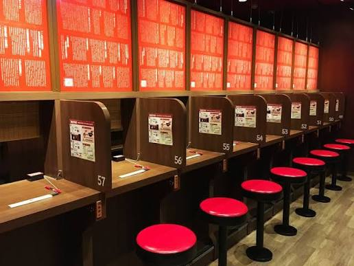

# Autonomous Researchers on the Kaggle Leaderboard

- **URL:** https://www.kaggle.com/competitions/rsna-knee-abnormality-detection/discussion/743916
- **Author:** **Quan Vu** (@quan0095, Master) · _topic author_ · 2026-09-27 18:26 UTC · ▲6 · LB rank 14
- **Topic votes:** 6 · **Comments/replies:** 13 · **Pinned:** no
- **Last comment:** 2026-09-30 10:38 UTC by Quan Vu
- **Cloned:** 2026-10-09 09:46 UTC (topic id 743916, raw JSON `_raw/743916.json`)

---

In June, Meta's AIRA placed 8th / 4,185 in NVIDIA's Nemotron challenge — reportedly the first Kaggle
gold won by an autonomous research system, graded on the same private LB as everyone else
([thread](https://threadreaderapp.com/thread/2096271545589190927.html)). Systems like ScientistTwo
([site](https://scientist-two.github.io/)) and KAPSO now claim expert-level results end-to-end.
I'm really curious to see whether a human-agent collaboration or fully autonomous research has more of an advantage, if allocated the same amount of GPU resources 😄

---

## Comments (13, threaded, oldest first)

### [1] Chris Deotte

**Chris Deotte** (@cdeotte, Grandmaster) · 2026-09-27 22:22 UTC · ▲6 · LB rank 100

I would suspect that currently "minimal human in the loop" would do better. But every months, agents are working better and better without human guidance.

I think there is some overlap between the expressions "fully autonomous" and "minimal human in the loop". (i.e. some people call the second the first and vice versa). I wonder how many Kagglers are doing "fully autonomous" which means we give our agent one prompt "Here is the URL of a Kaggle competition, please join and compete". And then humans offer no additional guidance.

I have been using "minimal human in the loop". I give an auto run agent a competition URL and say "join and compete" but I also ask the agent to display dashboards and write mini news briefs regularly explaining what it is doing and what it did do. I check in about once a day. And offer some guidance. So for the most part, the agents are working autonomously, but I do steer them here and there.

#### ↳ [1.1] Quan Vu

**Quan Vu** (@quan0095, Master) · _topic author_ · 2026-09-27 23:13 UTC · ▲4 · LB rank 14

I don't think it will be a 'minimal human-in-the-loop' scenario. When GPU resources for model training and Agent tokens are strictly limited—and the type of agent I'm using is identical to every other competitor's—the only lever left to pull is human effort. As a result, humans will inevitably spend more time trying to create a competitive edge 🫠

##### ↳ ↳ [1.1.1] Chris Deotte

**Chris Deotte** (@cdeotte, Grandmaster) · 2026-09-28 00:09 UTC · ▲1 · LB rank 100

Good point for now. However as agents get smarter and smarter (i.e. one million times smarter than humans), collaboration may be like a kindergardener (i.e. 5 year old) teaming with an adult (where the adult is agent is kindergardener is human) 😀 We are not there yet, but this day is coming.

##### ↳ ↳ [1.1.2] Quan Vu

**Quan Vu** (@quan0095, Master) · _topic author_ · 2026-09-28 00:17 UTC · ▲2 · LB rank 14

What you're describing is like ensembling an underfitted model with a strong model—the underfitted model will just drag the strong one down 😂

#### ↳ [1.2] Optimo

**Optimo** (@optimo, Master) · 2026-09-28 09:24 UTC · ▲4 · LB rank 57

I have joined this competition willing to try a "no code" approach, I did not write a single line myself. It feels great to be able to test a lot of ideas just by discussing them, but it is still a lot of work and human brain power for me (which is keeping things fun).

Before we reach the kindergardener mode, which is essentially a Kaggle artefact since a very simple prompt says it all : "join and win the competition" (even then, if every one has access to the same model/compute this will become a baseline, not a winning solution), I am wondering what type of people benefit the most from LLM agents?

Is it domain experts which can join without much knowledge on modelling? Or on the contrary, expert in AI which gain understanding of the specificity of the task?

What are the best qualities to have according to you to maximize human-machine interaction? Curiosity? Methodology (context, harness, prompting) ? Coding skills ? Critical thinking ? Does it benefits to organized people or messy geniuses ?

I would really be curious to know other people thoughts on this. For example @cdeotte, as a recognized world level grandmaster, do you feel like your are slowly losing your edge or on the contrary you feel like you are on a great spot to keep winning? What do you do to stay competitive ?

##### ↳ ↳ [1.2.1] Quan Vu

**Quan Vu** (@quan0095, Master) · _topic author_ · 2026-09-28 11:59 UTC · ▲2 · LB rank 14

I’m in the same boat as you. I went with a 'no-code' approach but had to discuss things so extensively with the agent that it eventually claimed there were no more feasible paths left to try. Even when retrieving external research papers, the bottleneck is that those methods still need to be verified—which in turn consumes valuable GPU resources. While domain experts can now build models without knowing how to code, the flip side is also true: as a software developer, I can now easily grasp domain-specific knowledge without any formal training.

##### ↳ ↳ [1.2.2] Quan Vu

**Quan Vu** (@quan0095, Master) · _topic author_ · 2026-09-28 13:16 UTC · ▲5 · LB rank 14

Additionally, I’ve noticed an interesting trend: while the number of competition participants is skyrocketing, the volume of discussions remains very low, especially technical ones. It might be that LLM agents are now so capable of answering technical questions that people no longer feel the need to post on the forums 😄

##### ↳ ↳ [1.2.3] RB

**RB** (@rashmibanthia, Master) · 2026-09-28 18:16 UTC · ▲2 · LB rank 131

There's lot more AI generated responses / posts on the forums - even though there are no medals.

##### ↳ ↳ [1.2.4] Tom

**Tom** (@tom99763, Master) · 2026-09-29 04:52 UTC · ▲6 · LB rank 1315

```
Additionally, I’ve noticed an interesting trend: while the number of competition participants is skyrocketing, the volume of discussions remains very low, especially technical ones
```

Previously computer vision competition is like 1000+ teams at most. I'm really surprised it's already 4500 teams here and almost 4000 teams in biohub. And it's really confused me about why the discussions are still low too. My expectation for now is people can quickly share what they find by html or md file and knowing what the idea is without spending lots of time on it.  However, it turns out that this place becomes the study room in "cram school" or "味集中カウンター" in ICHIRAN.  I don't think that's a good trend for the community.



##### ↳ ↳ [1.2.5] Quan Vu

**Quan Vu** (@quan0095, Master) · _topic author_ · 2026-09-29 11:53 UTC · ▲3 · LB rank 14

I think there are a few reasons. First, frontier models have leveled out skill across the community, and the gaps on the leaderboard are now very small. Second, LLMs are extremely good at reading and absorbing information: any finding posted on the forum gets picked up by almost every team right away. When the margins are only a few thousandths, sharing during a competition basically means giving away your own edge. Players still have to balance self-interest against the community's interest, but the scale has clearly tipped. Third, technical discussion is shifting from the forum to direct conversations with AI agents. These days, the most common question on the forum is "what does the host want?", which is something an agent can't answer. So I think the trend will be to share findings after a competition ends, rather than while it's still running.

##### ↳ ↳ [1.2.6] RB

**RB** (@rashmibanthia, Master) · 2026-09-29 12:00 UTC · LB rank 131

There's so much of AI generated text and solutions after the competition ends - I used to read lot more solutions (before they were written by AI) and now I often find myself either asking AI to explain solutions or sadly simply skip it.

### [2] (unknown)

**(unknown)** · 2026-09-29 20:46 UTC · ▲-1

_(no content — deleted or empty)_

### [3] Quan Vu

**Quan Vu** (@quan0095, Master) · _topic author_ · 2026-09-30 10:38 UTC · ▲2 · LB rank 14

On a personal note, I’ve tried participating in a few competitions where I had absolutely no domain knowledge, and the results weren’t very promising. Even with the help of the AI agent, it was still highly challenging to compete, mainly because I lacked a strong enough starting point to build upon. I couldn't provide high-quality guidance to help the agent iterate further, which left me mostly stagnating. Moreover, letting the agent search for solutions fully autonomously raises concerns about budget control and GPU resource constraints. The key takeaway is that humans still need to learn how to effectively collaborate with agents.
