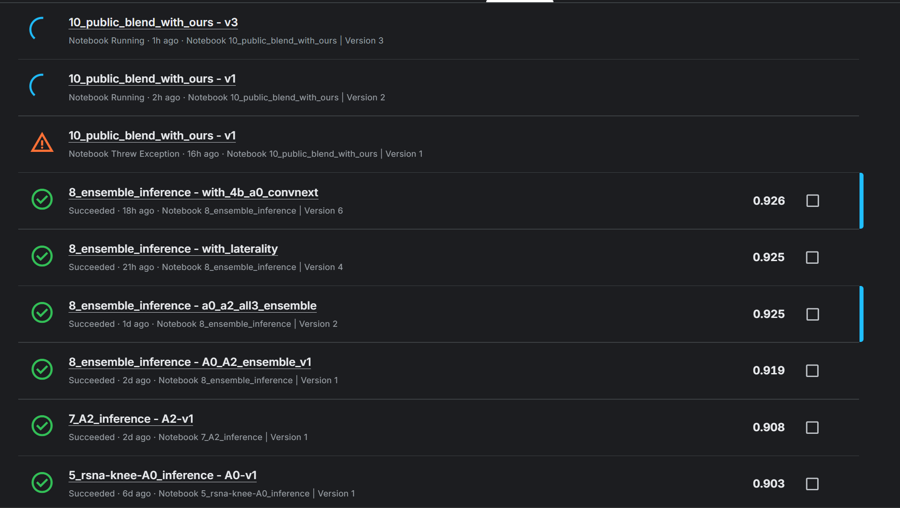

# The submission is stuck somehow. I need help.

- **URL:** https://www.kaggle.com/competitions/rsna-knee-abnormality-detection/discussion/745441
- **Author:** **Dhiyanesh Babu C V** (@dhiyaneshbabu, Contributor) · _topic author_ · 2026-10-03 05:26 UTC · ▲-2 · LB rank 1138
- **Topic votes:** -2 · **Comments/replies:** 3 · **Pinned:** no
- **Last comment:** 2026-10-04 13:10 UTC by Lavin Wins
- **Cloned:** 2026-10-09 09:46 UTC (topic id 745441, raw JSON `_raw/745441.json`)

---

I made a submission, but the notebook failed due to a path error. However, in the **Submission** tab, it is still showing as Running even after 1 hour.

I then made another submission. The notebook ran successfully on 3 test studies in about 5 minutes, but the submission has now been loading for more than 1.5 hours and is still showing as running.

Does Kaggle allow only one submission to run at a time? If the previous submission is stuck, could that be preventing my new submission from completing?

When I open the submission, it shows “Notebook failed and terminated”, but in the main **Submission** screen, it still shows Running.

How can I terminate or cancel the stuck submission? Any help would be appreciated.

---

## Comments (3, threaded, oldest first)

### [1] Dhiyanesh Babu C V

**Dhiyanesh Babu C V** (@dhiyaneshbabu, Contributor) · _topic author_ · 2026-10-03 05:27 UTC · LB rank 1138

#### ↳ [1.1] SpeedSci

**SpeedSci** (@caoyupeng, Expert) · 2026-10-03 07:34 UTC · LB rank 121

If the notebook runs for 5 minutes, the LB score does take a few hours to come back.

### [2] Lavin Wins

**Lavin Wins** (@lavinwins, Contributor) · 2026-10-04 13:10 UTC · ▲-1 · LB rank 602

Bro I guess you seriously are new.

It take people even 9 Hours to get the submission
