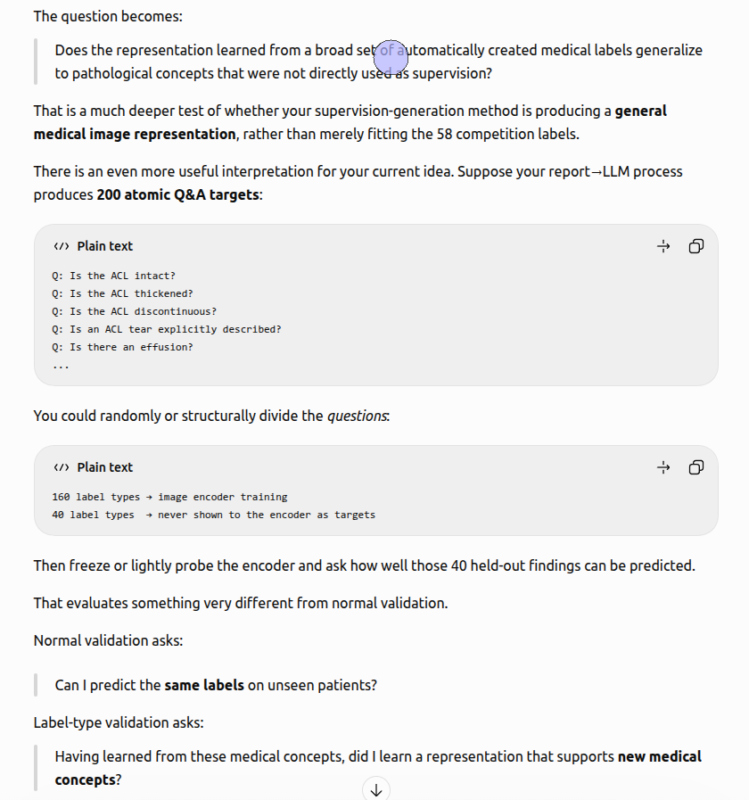

#  A Question About 5-Fold Cross-Validation Strategy

- **URL:** https://www.kaggle.com/competitions/rsna-knee-abnormality-detection/discussion/745823
- **Author:** **Renmq** (@renmingqian, Expert) · _topic author_ · 2026-10-04 16:26 UTC · ▲4 · LB rank 194
- **Topic votes:** 4 · **Comments/replies:** 3 · **Pinned:** no
- **Last comment:** 2026-10-06 05:36 UTC by hengck23
- **Cloned:** 2026-10-09 09:46 UTC (topic id 745823, raw JSON `_raw/745823.json`)

---

Hi everyone,

I have a question about how to properly perform 5-fold cross-validation for this competition. I would really appreciate it if anyone could share their experience or suggestions.

I currently have a single CoAtNet model that achieves around 0.940 on the leaderboard. This model was trained using all available training studies except for the 58 officially labeled studies. I kept those 58 studies completely out of training and used them only as a local validation set, where the model achieves a macro AUC of approximately 0.93.

I have been trying to improve this model using 5-fold cross-validation. However, despite running several experiments, I have not been able to obtain a better result.

I am wondering whether the validation strategy is especially important here. So far, I have tried the following approaches:

- Splitting the training data into five folds while continuing to use the same 58 officially labeled studies as the validation set for every fold.
- Using the held-out portion of each fold as that fold’s validation set.
- Creating the folds with a simple random split.
- Creating the folds while trying to balance the distributions of all 12 labels across the five folds.

Unfortunately, none of these approaches has produced a meaningful improvement for me.

Has anyone encountered a similar situation? May I ask how you construct your folds and choose the validation set? Do you include the 58 officially labeled studies in training, keep them as a separate validation set, or handle them in another way?

I may be misunderstanding or overlooking something important in my cross-validation setup, so any advice or shared experience would be greatly appreciated.

Thank you very much!

---

## Comments (3, threaded, oldest first)

### [1] Steve421471

**Steve421471** (@steve421471, Contributor) · 2026-10-05 19:32 UTC · LB rank 604

I think your approach is fine (though i would skip manually balancing labels across folds). I would look at how you're feeding the training data into the model. Different image parameters can produce different outputs.

### [2] hengck23

**hengck23** (@hengck23, Grandmaster) · 2026-10-06 05:31 UTC · ▲1 · LB rank 693

you only have 58 gold labels. Maybe you need to rethink of the validation method in this competition.

This competition is mainly about creating supervision (from medical records). Instead of the normal split of data for validation, how about the split of label types for validation .... assuming you have many created label types.

#### ↳ [2.1] hengck23

**hengck23** (@hengck23, Grandmaster) · 2026-10-06 05:36 UTC · LB rank 693

chatgpt explain better than i do, so i just cut and paste his comment

