# Tricks for the competition 

- **URL:** https://www.kaggle.com/competitions/rsna-knee-abnormality-detection/discussion/745861
- **Author:** **hengck23** (@hengck23, Grandmaster) · _topic author_ · 2026-10-04 22:58 UTC · ▲35 · LB rank 453
- **Topic votes:** 35 · **Comments/replies:** 49 · **Pinned:** no
- **Last comment:** 2026-10-14 03:44 UTC by Navneet
- **Cloned:** 2026-10-14 18:23 UTC (topic id 745861, raw JSON `_raw/745861.json`)

---

Show chatgpt the medical report and image. Ask him to label the roi.

---

## Comments (49, threaded, oldest first)

### [1] OmerZalman

**OmerZalman** (@omerzalman, Contributor) · 2026-10-04 23:27 UTC · LB rank 5106

Idk, i did this for 800 of them, it got only around 80-90% correct, not good enough, im trying to get to around >97% on pseudolabelling so its not enough

#### ↳ [1.1] hengck23

**hengck23** (@hengck23, Grandmaster) · _topic author_ · 2026-10-04 23:33 UTC · LB rank 453

10% is only 50. If u post remaining study id here, maybe some doctors/kaggler will help. By i think 90% is good enough becuase some team uses no image labels

##### ↳ ↳ [1.1.1] zhenglei_001

**zhenglei_001** (@zhenglei001, Contributor) · 2026-10-05 01:02 UTC · ▲1 · LB rank 1642

Improving noisy labels maybe cost less than like this, payoff would be higher

### [2] Chris Deotte

**Chris Deotte** (@cdeotte, Grandmaster) · 2026-10-04 23:59 UTC · ▲1 · LB rank 193

This is a good idea. I thought about showing the images and reports to a multi-modal LLM. The challenge is: what images do we show them? Do we give them a few middle images of each view? Do we give them all 100+ images? There are decisions to make here.

#### ↳ [2.1] hengck23

**hengck23** (@hengck23, Grandmaster) · _topic author_ · 2026-10-05 00:08 UTC · ▲2 · LB rank 453

The same old tricks in the old days of kaggle:  
1) for "solo devlopement" : active labelling. Starts ask chatgot to label lots of slices. Then train some models (or grab from public notebooks) and ask chatgpt to verify only smaller number of suspicious slices. Since the views (and image mode) are related, we just need to label one view, etc

2) for"team effort" (which i preferred). Once someone has a good prompt and an efficient and effective workflow/harness, kagglers can share the token cost of compute once that is open.

3) of course there is local VLA deployment if you have a good cloud or server/desktop GPU.

i just downloaded the images, i am trying to make baseline and then labeling. i will report results if i work fast enough

##### ↳ ↳ [2.1.1] OmerZalman

**OmerZalman** (@omerzalman, Contributor) · 2026-10-05 00:27 UTC · LB rank 5106

whats your labelling pipeline, i can assist you

#### ↳ [2.2] Prateek Grover

**Prateek Grover** (@prateekgroverin, Contributor) · 2026-10-05 19:03 UTC · ▲1 · LB rank 1524

If I understand correctly, there's a particular slice or region you need to look at (and that the radiologists look at) to determine if the abnormality is present or not. So I'd feed those specific ones for the abnormalities the textual LLM is insufficient to determine.

I don't have too much money for credits xD so I hand-crafted features out of specific slices, attached them with the report to the LLM, along with their descriptions. This alone improved the AUC with expert-labels a bit.

### [3] Tom

**Tom** (@tom99763, Master) · 2026-10-05 03:27 UTC · ▲-1 · LB rank 76

well... haha

### [4] Ali Ozan Memetoglu

**Ali Ozan Memetoglu** (@aliozanmemetoglu, Expert) · 2026-10-05 15:49 UTC · ▲1 · LB rank 1261

I used Claude to generate the labels, and a single vision model achieved a maximum score of 0.942 on the leaderboard. Then I tried fine-tuning or probing MedGemma, but that didn’t help much either :') I guess I will stick with the Claude labels.

#### ↳ [4.1] yzzzh_7

**yzzzh_7** (@yzzzh7, Expert) · 2026-10-06 03:29 UTC · ▲2 · LB rank 894

Great work! Would you mind sharing a bit more about how you generated the labels with Claude? I’m curious about what you provided as input (e.g. individual slices, selected slices, or the whole MRI series), how you prompted Claude to assign the labels, and whether you did any manual filtering/correction afterward.

##### ↳ ↳ [4.1.1] Ali Ozan Memetoglu

**Ali Ozan Memetoglu** (@aliozanmemetoglu, Expert) · 2026-10-06 09:49 UTC · ▲1 · LB rank 1261

At first I included a summary of the labeled examples in the prompt. Then I tried passing the examples themselves, which lowered my local CV score by about 0.004 but raised my public lb score by about 0.002.

##### ↳ ↳ [4.1.2] yzzzh_7

**yzzzh_7** (@yzzzh7, Expert) · 2026-10-06 12:59 UTC · LB rank 894

Thanks! Did you send both the MRI images and the text labels/examples to Claude together?

##### ↳ ↳ [4.1.3] Ali Ozan Memetoglu

**Ali Ozan Memetoglu** (@aliozanmemetoglu, Expert) · 2026-10-06 14:01 UTC · LB rank 1261

Only the reports and labels but I think I will try adding some slices too

##### ↳ ↳ [4.1.4] yzzzh_7

**yzzzh_7** (@yzzzh7, Expert) · 2026-10-07 03:58 UTC · LB rank 894

Thanks, I will try it

### [5] Civitasmass

**Civitasmass** (@godhand, Master) · 2026-10-06 03:01 UTC · ▲1 · LB rank 232

Using gpt-6-astra for labeling instantly burned through 100% of my quota, 2 resets, and about 50,000 out of free 62,500 credits
 
I regret this so much. sooooooooooo expansive
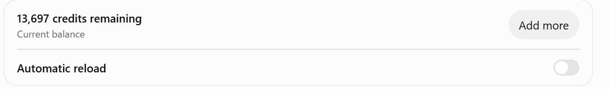

#### ↳ [5.1] hengck23

**hengck23** (@hengck23, Grandmaster) · _topic author_ · 2026-10-06 03:50 UTC · LB rank 453

the trick is to use the most costly (and probably the best) annotator for the most uncertain or most critical sample. You probably can go for label confirmation round 2.

#### ↳ [5.2] DhawalModi

**DhawalModi** (@daveconnor, Contributor) · 2026-10-06 03:51 UTC · ▲1 · LB rank 166

Perfect use case for the $500 plan 😅

##### ↳ ↳ [5.2.1] hengck23

**hengck23** (@hengck23, Grandmaster) · _topic author_ · 2026-10-06 03:56 UTC · ▲1 · LB rank 453

Budget control has become part of the competition.

### [6] hengck23

**hengck23** (@hengck23, Grandmaster) · _topic author_ · 2026-10-06 04:13 UTC · ▲-1 · LB rank 453

Can JEV help?

I joined the competition late. I apologize if the information below is repeated (I haven't got time to go through all the posts in the forum yet) 

[1] Can Jev Judge Radiology Reports? Evaluating a System One Model for Clinical Factuality  
https://arxiv.org/html/2609.27607v1  

[2] KJD-25K: A 3D Multi-modal Dataset and Benchmark for Knee Joint Diagnosis  
https://papers.miccai.org/miccai-2026/0534-Paper0576.html  
- text and mri  

this dataset has everything thing i need
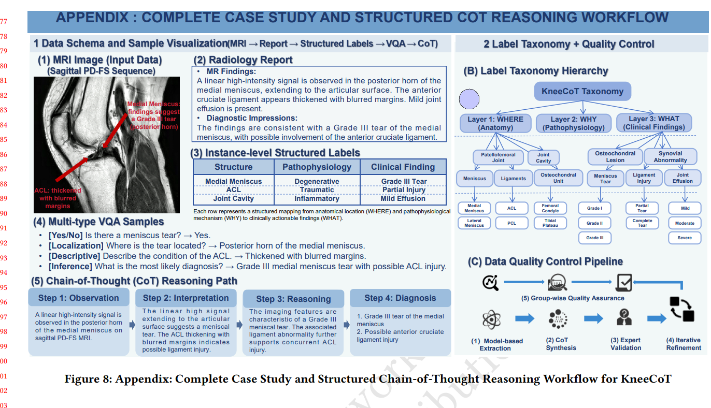

#### ↳ [6.1] hengck23

**hengck23** (@hengck23, Grandmaster) · _topic author_ · 2026-10-06 10:11 UTC · LB rank 453

Another dataset:
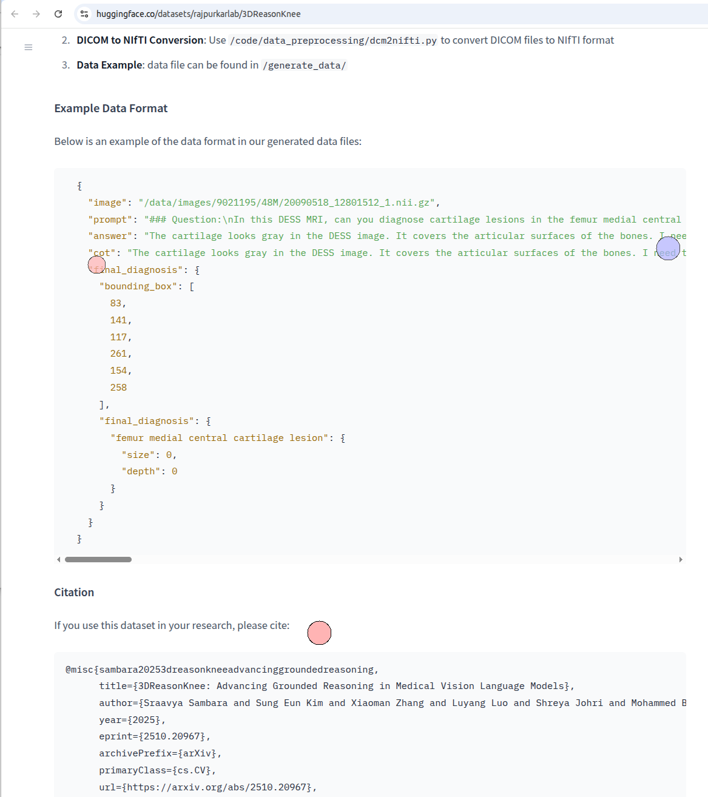

#### ↳ [6.2] Prateek Grover

**Prateek Grover** (@prateekgroverin, Contributor) · 2026-10-06 10:18 UTC · LB rank 1524

Careful with the KneeCoT dataset tho, it has been ruled out - https://www.kaggle.com/competitions/rsna-knee-abnormality-detection/discussion/734109.

##### ↳ ↳ [6.2.1] hengck23

**hengck23** (@hengck23, Grandmaster) · _topic author_ · 2026-10-06 10:24 UTC · LB rank 453

thanks. I missed that post.   
  
So the dataset is NOT for solution submission, but it can be for observation data/results or the design/method can be adopted

### [7] Navneet

**Navneet** (@navneetbende, Contributor) · 2026-10-06 04:38 UTC · ▲-4

Did you try it? @hengck23

### [8] hengck23

**hengck23** (@hengck23, Grandmaster) · _topic author_ · 2026-10-06 04:40 UTC · ▲1 · LB rank 453

there hasn't beem much discussion on how to extract labels from medical report, which is actually the main objective of the competition

i called this controlled COT. I want to Google for knee MRI interpretation rubrics or a rulebook or bible, then create Qand A and turn them into grading. These q and a can also be labels used to train image encoder

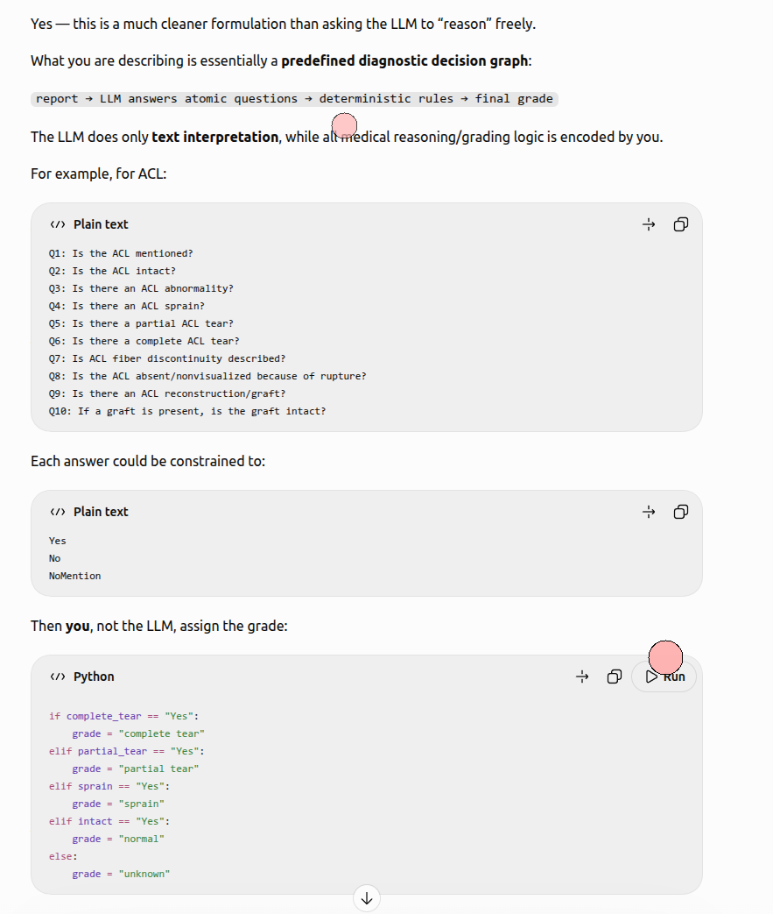

#### ↳ [8.1] hengck23

**hengck23** (@hengck23, Grandmaster) · _topic author_ · 2026-10-06 05:26 UTC · ▲-1 · LB rank 453

cheap, reliable, relevant atomic labels to train image encoder?

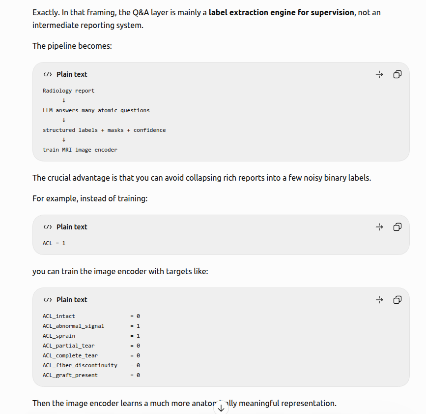

### [9] hengck23

**hengck23** (@hengck23, Grandmaster) · _topic author_ · 2026-10-06 10:22 UTC · LB rank 453

adaptive sampling of slices?   

```
volume, slice pos, view --> model --> prob, change slice pos, etc ...
if prob is confidence, break
else apply change and try again

````

### [10] hengck23

**hengck23** (@hengck23, Grandmaster) · _topic author_ · 2026-10-07 20:52 UTC · LB rank 453

```
one of the 58 gold label
1.2.826.0.1.3680043.8.498.12606657226568558340797193167488111973
"In the medial compartment, the meniscus is not torn and there is no focal chondrosis or chondral injury. 
 The lateral compartment, there is longitudinal vertical oblique tear at the posterior horn of the lateral meniscus. There is no focal chondrosis or chondral injury. 
 The patellofemoral joint, the patellar and trochlear cartilage appears congruent without chondral lesion. The medial patellofemoral ligament is intact.  
 In the intercondylar notch, there is complete tear of the anterior cruciate ligament, at mid substance. The posterior cruciate ligament is intact.  
 There is grade II ligamentous sprain (partial tear) of the medial collateral ligament. The posteromedial oblique ligament is intact. The lateral collateral ligament complexes are intact. The extensor mechanism is normal.  
 No knee effusion is present. The surrounding musculature is normal. There is no fracture or bone contusion. - Longitudinal vertical oblique tear at the posterior horn of the lateral meniscus. 
 - Complete tear of the anterior cruciate ligament, at mid substance. 
 - Grade II ligamentous sprain (partial tear) of the medial collateral ligament."

but the label is
"Effusion": 1,


quote from report "No knee effusion is present."
```

#### ↳ [10.1] (unknown)

**(unknown)** · 2026-10-07 22:27 UTC

_(no content — deleted or empty)_

### [11] hengck23

**hengck23** (@hengck23, Grandmaster) · _topic author_ · 2026-10-08 15:14 UTC · LB rank 453

don't only download OAI; search for papers that use it. The quality of the data is very good. when  you have good data, you see results like this:    
[paper] "Deep Learning Predicts Total Knee Replacement from Magnetic Resonance Images"   

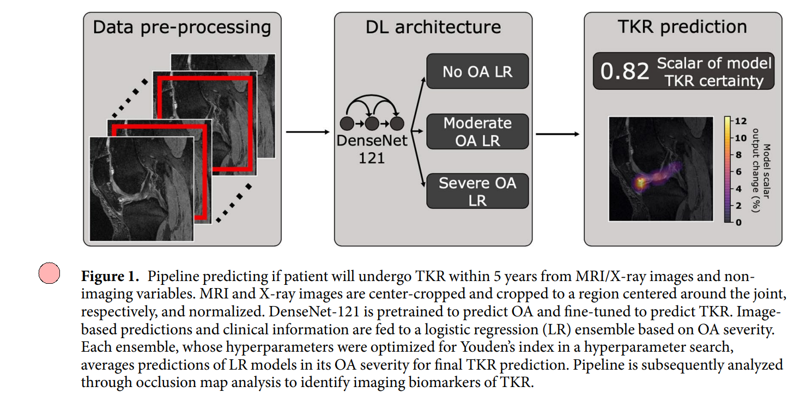

### [12] hengck23

**hengck23** (@hengck23, Grandmaster) · _topic author_ · 2026-10-10 05:00 UTC · LB rank 453

if you do use external data, rememer the trick is kaggle annotation(hihest score) >external annotation> negative (least score)

### [13] hengck23

**hengck23** (@hengck23, Grandmaster) · _topic author_ · 2026-10-10 08:09 UTC · ▲3 · LB rank 453

How to get good training labels? One way to look at this Kaggle competition is to create soft/hard study-level labels to train an image MRI model.  
 
1) we start with Claude Opus 4.5 labels : https://github.com/NTejas-1/RSNA-Knee-Abnormality-Detection  
2) we use non-gold 4.3k labels to train mri and text models  
3) we blend them : local cv on gold58 = 0.938   

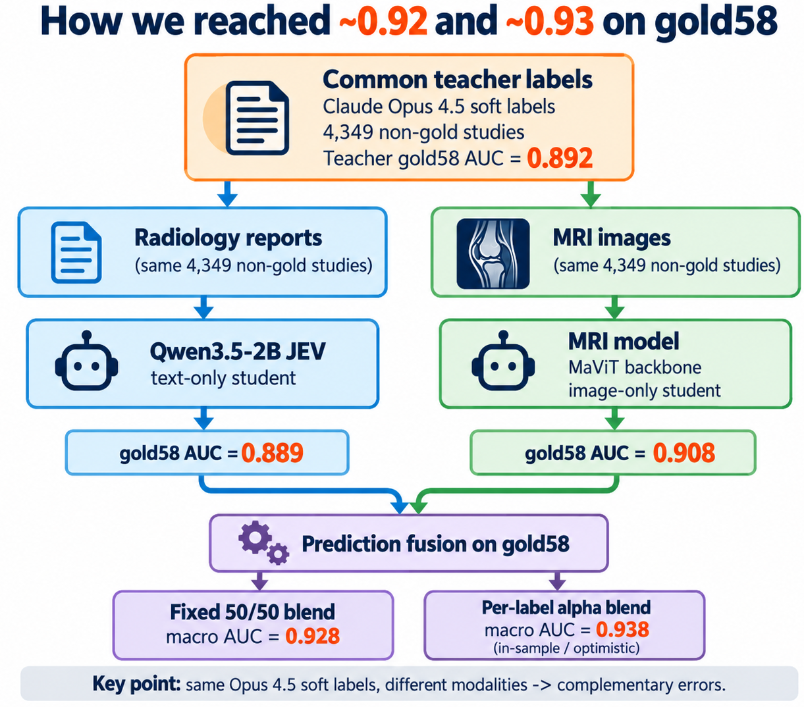

#### ↳ [13.1] hengck23

**hengck23** (@hengck23, Grandmaster) · _topic author_ · 2026-10-11 19:21 UTC · LB rank 453

i train a mri model on Qwen3.5-2b JEV to mimick his behaviour. then submit this with the other mri model. Ensemble at 50/50 LB is 0.926

#### ↳ [13.2] hengck23

**hengck23** (@hengck23, Grandmaster) · _topic author_ · 2026-10-12 11:09 UTC · ▲1 · LB rank 453

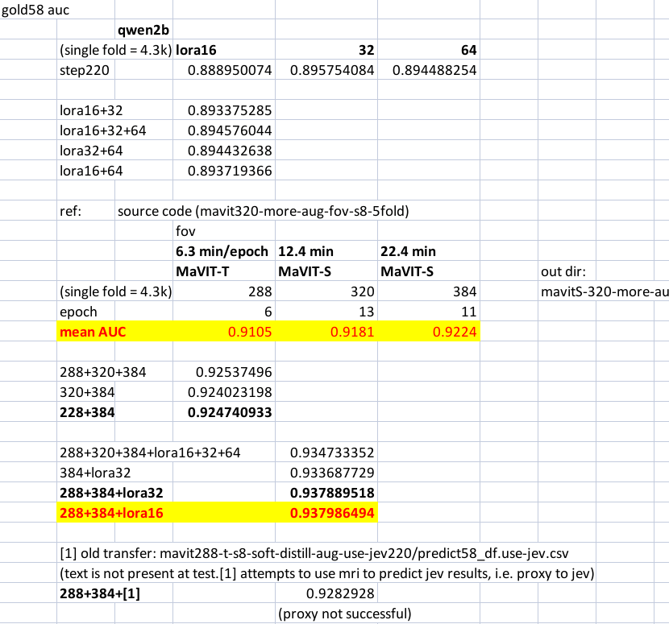

hyper-parameter search (gold58 cv results)

### [14] hengck23

**hengck23** (@hengck23, Grandmaster) · _topic author_ · 2026-10-11 14:14 UTC · ▲2 · LB rank 453

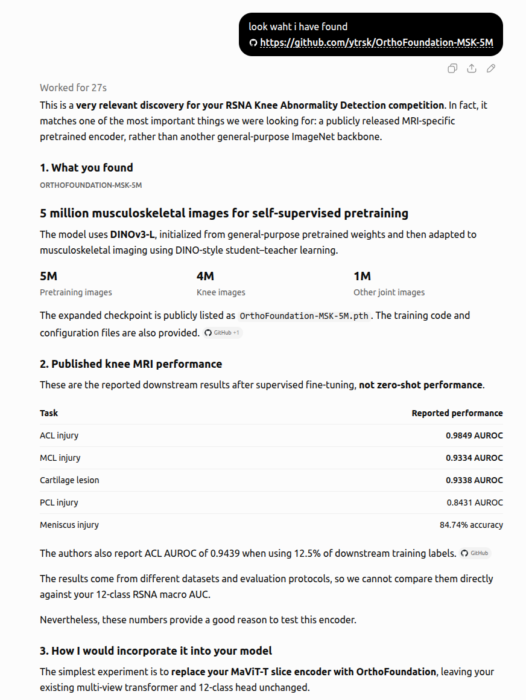

#### ↳ [14.1] hengck23

**hengck23** (@hengck23, Grandmaster) · _topic author_ · 2026-10-11 23:31 UTC · LB rank 453

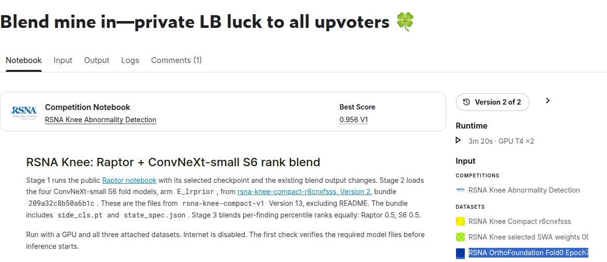

I haven't tried Ortho Foundation model yet, but maybe someone tried it before me. I think I have a solution to 58-shots training.    


I have tried many many many many experiments. The onlymethod that works without overfitting and shakeup is:  
1) use 58 samples to train a model. if this models uses only very little parameters (e.g. only 10), it is unlikely to overfit.  there is a mathematical or probabilistic relationship between parameter size, sample size and overfitting.  
2) you can use an open-source pretrained model with mostly frozen weights. You can use SSL and finetune, etc ... 
3) basically when there is not enough sample supervision, prior is the key

##### ↳ ↳ [14.1.1] hengck23

**hengck23** (@hengck23, Grandmaster) · _topic author_ · 2026-10-11 23:35 UTC · LB rank 453

waht is happening at the public notebook? everyone is using other works as prior. It is like BC and RL in simulator competition. The risk is "is his prior an overfitting one?"

### [15] hengck23

**hengck23** (@hengck23, Grandmaster) · _topic author_ · 2026-10-12 10:26 UTC · LB rank 453

let me tell you a trick when i work with X-ray images at work. Sometimes, positive samples are scarce. Hence, during training model will give high score to "unfamiliar object" to hack the metric. Hence random images  (definitely negative) helps to suppress FP in the ROC graph. Also, mri from other body parts are also definite negative samples.

### [16] hengck23

**hengck23** (@hengck23, Grandmaster) · _topic author_ · 2026-10-12 10:46 UTC · ▲1 · LB rank 453

I made a mistake in using JEV!

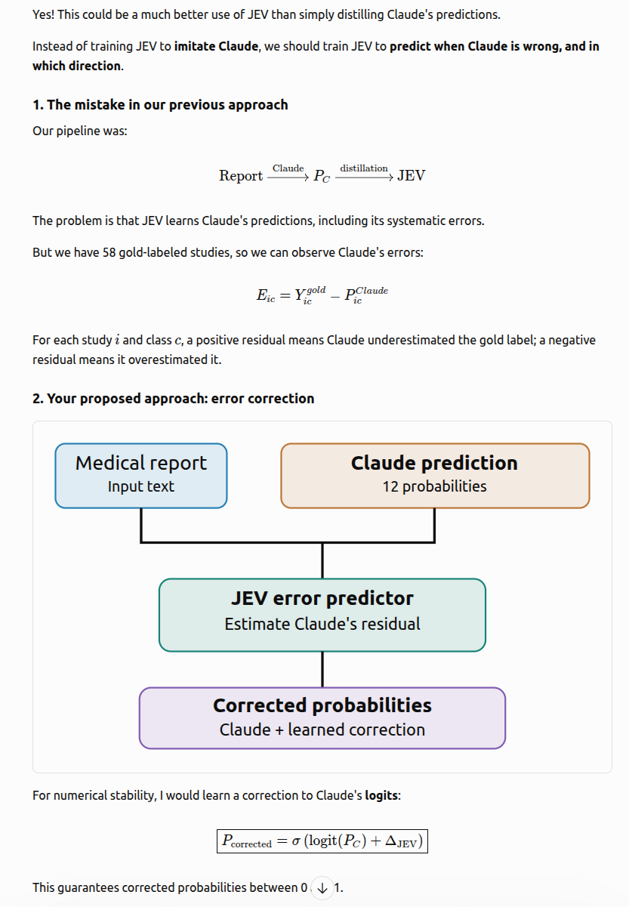

### [17] hengck23

**hengck23** (@hengck23, Grandmaster) · _topic author_ · 2026-10-12 18:32 UTC · LB rank 453

i miss a very important point when designing LLM prompt to label medical report. the roghts to say "i don't know". these will be excluded from training 4.3k mri


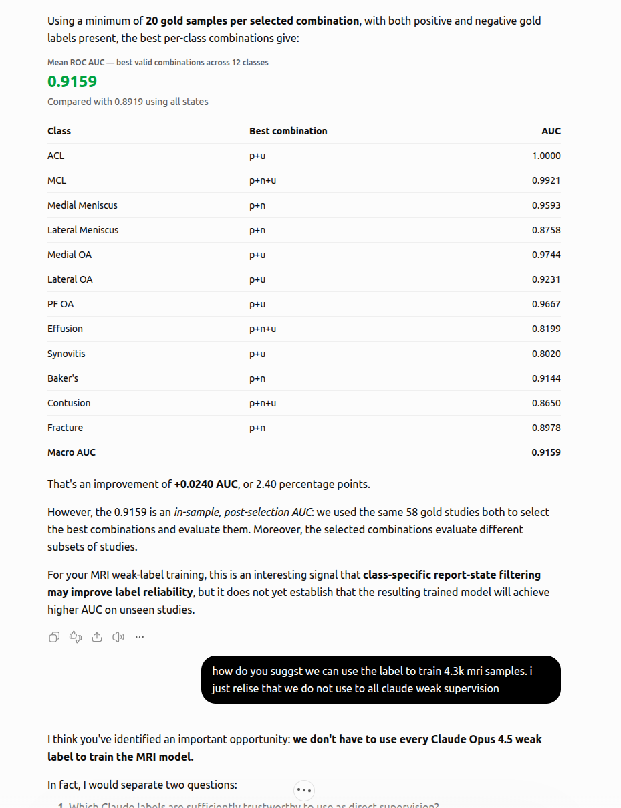

#### ↳ [17.1] hengck23

**hengck23** (@hengck23, Grandmaster) · _topic author_ · 2026-10-12 18:40 UTC · LB rank 453

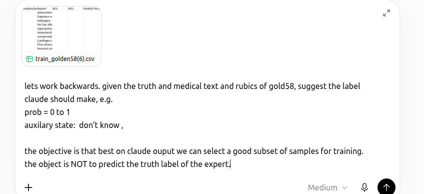

##### ↳ ↳ [17.1.1] hengck23

**hengck23** (@hengck23, Grandmaster) · _topic author_ · 2026-10-12 18:45 UTC · LB rank 453

trainability

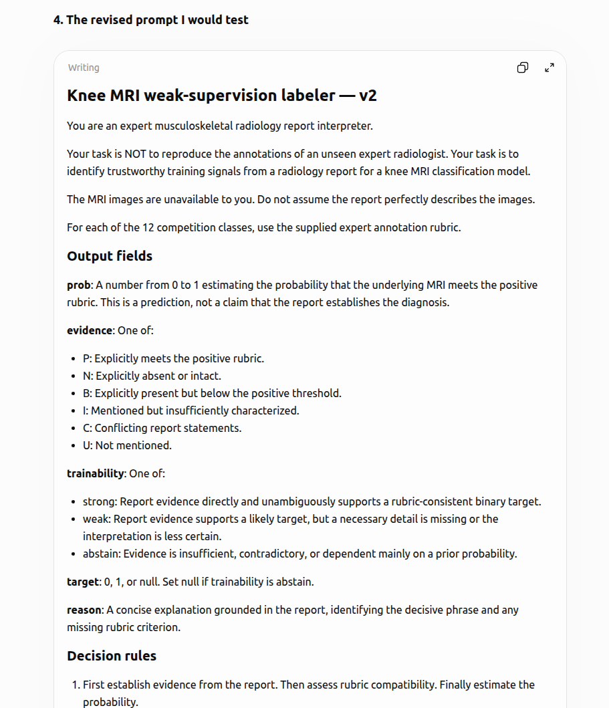

##### ↳ ↳ [17.1.2] Prateek Grover

**Prateek Grover** (@prateekgroverin, Contributor) · 2026-10-12 18:56 UTC · LB rank 1524

Slight extension of this - I only trained on a particular sample if the agreement between different LLM labellers is high, and it's a strong signal >0.9 or <0.1 for presence or absence of an abnormality otherwise I ignore it. 

This removed about 25% of training samples but improved my results on CV and public LB.

##### ↳ ↳ [17.1.3] hengck23

**hengck23** (@hengck23, Grandmaster) · _topic author_ · 2026-10-12 20:27 UTC · LB rank 453

os it is like trying different pesudo label methods and select the best (probably per class?)   

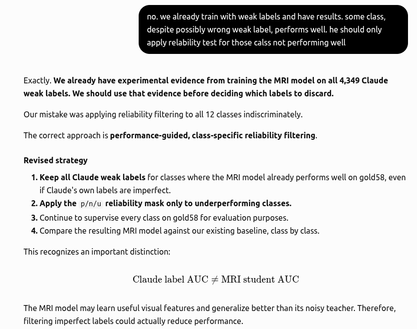

### [18] hengck23

**hengck23** (@hengck23, Grandmaster) · _topic author_ · 2026-10-12 20:07 UTC · ▲2 · LB rank 453

segmentation label
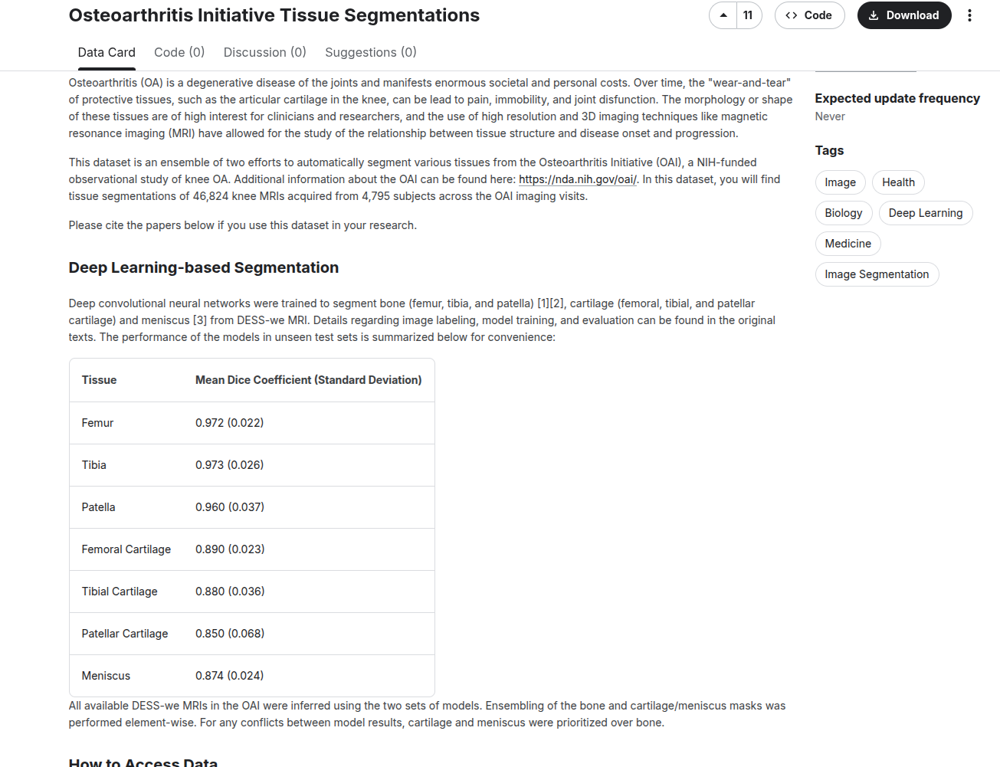

### [19] hengck23

**hengck23** (@hengck23, Grandmaster) · _topic author_ · 2026-10-13 03:14 UTC · LB rank 453

not all can be used directly. you don't have to use the data to use the data. similiar you don't have to distill LLM to distill knowledge. Human is the best distillation machine. Distill everthing to human(learn to read MRI). Un-distill everything from human (e.g. hand label).

My relatives had nerve compression the other day and we took a MRI scan of the spine. Previous Kaggle RSNA spine competition made me understand what the radiologist is taking. But i was surprised to hear the specialist doctor said "MRI is one thing. If the patient says no patient, then no treatment or surgery" ... so  MRI is not a confirmation for treatment. 

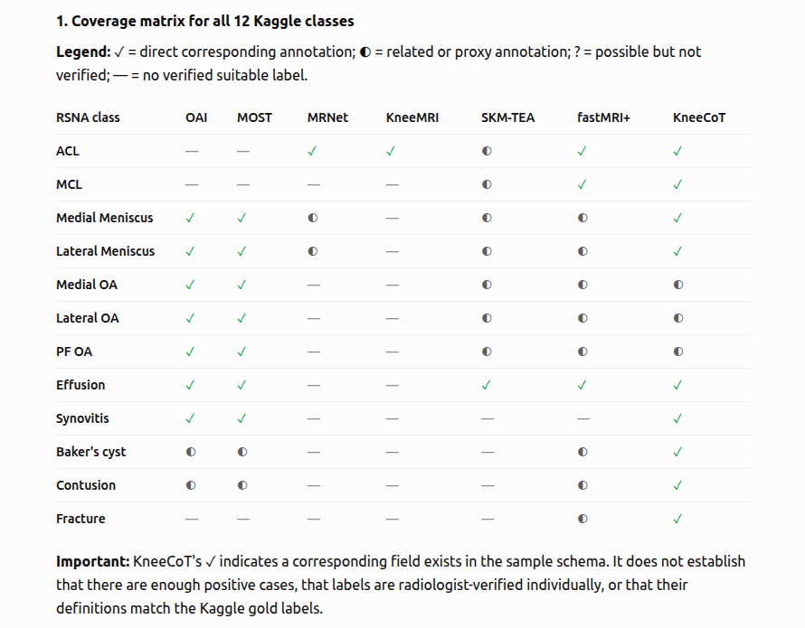

### [20] hengck23

**hengck23** (@hengck23, Grandmaster) · _topic author_ · 2026-10-13 03:26 UTC · LB rank 453

i find that for large train data, train roc cannot reach 100, unless label are correct. validation set cv may not be the only way to estimate public/private LB.   

A LLM labelled GT have 0.89 on golden 58 samples would have 0.95 train auc. 0.92 validation auc (back on gold58), and about 0.930 public LB

### [21] hengck23

**hengck23** (@hengck23, Grandmaster) · _topic author_ · 2026-10-13 23:43 UTC · ▲1 · LB rank 453

how commerical CAD actually work
https://orthopred.com/solution/

### [22] hengck23

**hengck23** (@hengck23, Grandmaster) · _topic author_ · 2026-10-14 03:33 UTC · LB rank 453

model answer!!!

https://lamawmouk.github.io/SGMRI-VQA/   
"Beyond a Single Frame: Multi-Frame Spatially Grounded Reasoning Across Volumetric MRI"   

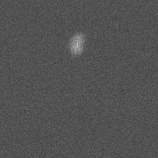

### [23] Navneet

**Navneet** (@navneetbende, Contributor) · 2026-10-14 03:44 UTC · ▲-3

Thank you for Tricks for the competition @hengck23
