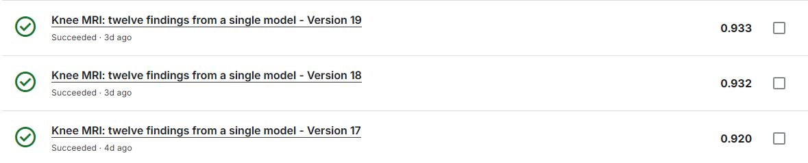

# Can we reach 0.93+ using only Kaggle resources in a few days? Looking for tips!

- **URL:** https://www.kaggle.com/competitions/rsna-knee-abnormality-detection/discussion/746124
- **Author:** **Arun** (@oldwine357, Expert) · _topic author_ · 2026-10-06 02:16 UTC · ▲7 · LB rank 1691
- **Topic votes:** 7 · **Comments/replies:** 14 · **Pinned:** no
- **Last comment:** 2026-10-11 05:38 UTC by Arun
- **Cloned:** 2026-10-14 18:23 UTC (topic id 746124, raw JSON `_raw/746124.json`)

---

I just joined the competition and started by building an EfficientNet model from scratch, which currently scores 0.85 (local cv). I know the public notebooks are overfitting, so I am planning a few data augmentation experiments next. (for now submitted what ever is publicly available)

Before moving on to the current meta (like DinoV2), I wanted to ask: is it realistic to hit a 0.93+ score within the next few days using only Kaggle compute resources? Also, I would highly appreciate any tips, tricks, or advice you might have for bridging this gap!

**Update 1:**

| Model | Local | Public |
| :--- | :---: | :---: |
| EfficientNet | 0.89 | 0.88 |

 

**Update 2:**

| Model | Local | Public |
| :--- | :---: | :---: |
| EfficientNet | 0.91 | 0.91 |

 

**Update 3:**

| Model | Local | Public |
| :--- | :---: | :---: |
| EfficientNet | 0.92 | 0.92 |

---

## Comments (14, threaded, oldest first)

### [1] Mingquan Zhuang

**Mingquan Zhuang** (@mingquanzhuang, Contributor) · 2026-10-06 11:52 UTC · ▲1 · LB rank 3189

I reproduced a publicly shared multi-arm inference notebook on Kaggle compute and got 0.936 on the public leaderboard, so 0.93+ is feasible as a reproduction using attached pretrained weights. The notebook I used is Anhad Mahajan's 'RSNA Knee: Take Care Of Your Knee' (https://www.kaggle.com/code/anhadmahajan06/rsna-knee-take-care-of-your-knee). That is very different from training a new 0.93+ model from scratch in a few days.

For your own EfficientNet experiments, I would keep patient/study-level folds fixed, report per-finding AUC as well as the mean, and change one augmentation or input choice at a time. Compare each change on the same local folds before spending submissions on the public leaderboard. A public score alone can mislead, especially when a model is tuned against that split.

One practical reproducibility detail: depending on how the competition is attached, its data can appear under /kaggle/input/competitions/rsna-knee-abnormality-detection or /kaggle/input/rsna-knee-abnormality-detection, so check the mounted path before running a fork.

#### ↳ [1.1] Arun

**Arun** (@oldwine357, Expert) · _topic author_ · 2026-10-06 14:09 UTC · LB rank 1691

Hey thanks for input.

### [2] Debmalya

**Debmalya** (@debmalya84, Contributor) · 2026-10-06 14:15 UTC · ▲1 · LB rank 1502

I have reached 0.945 just by using my laptop - RTX 4060, a 24core processor and 24GB RAM. I have done a lot of custom coding in rust to avoid memory issue in my laptop. I used Kaggle only to extract corpus from DICOM and to verify certain notebooks.

#### ↳ [2.1] Arun

**Arun** (@oldwine357, Expert) · _topic author_ · 2026-10-07 05:46 UTC · LB rank 1691

okay, thanks for sharing.

### [3] Cody_Null

**Cody_Null** (@cody11null, Grandmaster) · 2026-10-06 14:35 UTC · ▲2 · LB rank 100

If you follow the advise of @tuckerarrants I think you could very quickly get to 0.93 LB with efficientnetb0 or resnet18. Each of these would be small enough to progress quickly in a kaggle instance

#### ↳ [3.1] Arun

**Arun** (@oldwine357, Expert) · _topic author_ · 2026-10-07 05:45 UTC · LB rank 1691

- Baseline Performance: Achieve up to 0.94 accuracy using single EfficientNet-B0 and ResNet-50 models.
- Resolution Impact: Image dimensions of 288×288 and 326×326.
- Efficiency Boost: Utilize dataset caching to significantly cut down training time.
- Knowledge Sharing: Study top-rated public notebooks with detailed comments for architecture and pipeline insights.
- Semi-Supervised Learning: Apply pseudo-labeling techniques to further boost model generalization.
- Explore labelling.

Let me knw if I missed any

##### ↳ ↳ [3.1.1] Mingquan Zhuang

**Mingquan Zhuang** (@mingquanzhuang, Contributor) · 2026-10-07 09:35 UTC · LB rank 3189

On your 'Explore labelling' point: I tried a small report-to-label pilot (3 reports x 12 findings). The main trap was treating an unmentioned finding as a negative. I kept a third state, unknown, and required an exact report quote for every positive or negative label. One report had been clipped at 800 characters, so I excluded it from the draft pseudo-labels rather than interpreting the missing tail as evidence. Before scaling this up, I would audit class-wise errors against the fully labelled studies and keep reports out of the inference pipeline, since the test set has no reports. This is a labeling workflow observation, not a model-score claim.

### [4] MengYe

**MengYe** (@konohayui, Expert) · 2026-10-06 18:50 UTC · ▲3 · LB rank 1357

yes. I modified @dreaddevelopment training and inference notebook, https://www.kaggle.com/code/dreaddevelopment/knee-mri-training-the-twelve-finding-model, with public labels.

#### ↳ [4.1] Arun

**Arun** (@oldwine357, Expert) · _topic author_ · 2026-10-07 05:40 UTC · LB rank 1691

Thanks for the insights

##### ↳ ↳ [4.1.1] (unknown)

**(unknown)** · 2026-10-07 14:13 UTC

_(no content — deleted or empty)_

#### ↳ [4.2] Arun

**Arun** (@oldwine357, Expert) · _topic author_ · 2026-10-07 14:13 UTC · LB rank 1691

Hey @konohayui, just wanted to check did you train using above notebook, CoAtNet-384 consume huge amt of kaggle GPU. Stopped it half way.

##### ↳ ↳ [4.2.1] MengYe

**MengYe** (@konohayui, Expert) · 2026-10-08 00:20 UTC · LB rank 1357

yes, i make some modifications to fit the kaggle notebook constraints, i didn't use coatnet_rmlp_2_rw_384 but coatnet_0_rw.

##### ↳ ↳ [4.2.2] Arun

**Arun** (@oldwine357, Expert) · _topic author_ · 2026-10-11 05:38 UTC · LB rank 1691

Ok got it, thx.

### [5] (unknown)

**(unknown)** · 2026-10-07 08:27 UTC

can you help me to fine module run with kaggle.com good with codeing
