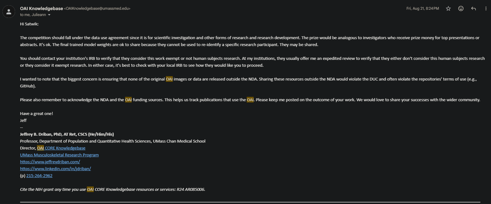
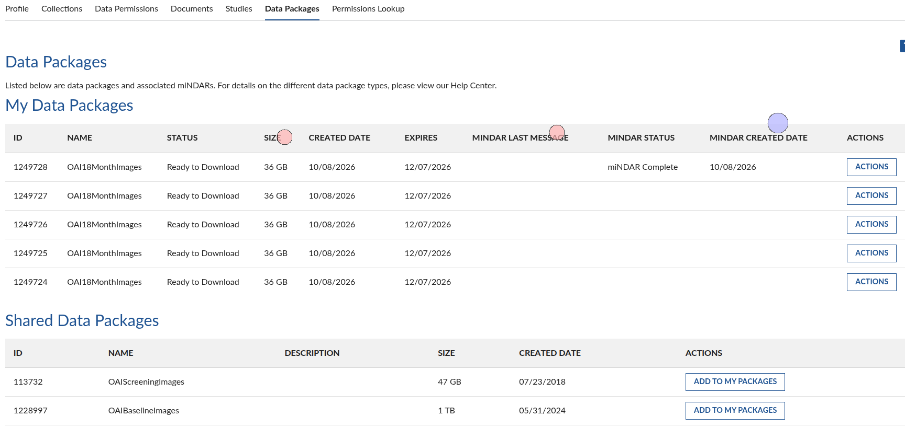
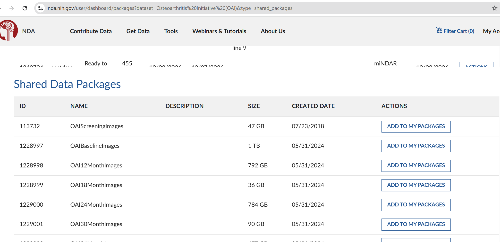

# Reaching 0.949 with one CoAtNet: labels, native crops, and anatomical mirroring

- **URL:** https://www.kaggle.com/competitions/rsna-knee-abnormality-detection/discussion/746792
- **Author:** **Danial Zakaria** (@nartaa, Expert) · _topic author_ · 2026-10-07 19:34 UTC · ▲41 · LB rank 1073
- **Topic votes:** 41 · **Comments/replies:** 56 · **Pinned:** no
- **Last comment:** 2026-10-13 11:26 UTC by varshitha kolupuri
- **Cloned:** 2026-10-14 18:23 UTC (topic id 746792, raw JSON `_raw/746792.json`)

---

Our best single-model submission scores **0.949 public AUC**. We are sharing the accuracy recipe, our smaller 0.945 model for the efficiency track, and several changes that did not help.

The accuracy result uses one CoAtNet checkpoint trained at 384 pixels. At inference we take a native 320-pixel center crop and average probabilities from the original view and an anatomical left/right mirror. It is one learned model evaluated twice. The checkpoint itself averages three selected epochs from one training run, called SWA in our code.

## The score history

These are ordinary, full twelve-finding public leaderboard scores. Rows describe successive pipeline configurations; their differences are not all isolated causal effects.

| Configuration | Public AUC | Change |
|---|---:|---:|
| Our all-data CoAtNet, 80 slices and 78 windows | 0.939 | Starting point |
| 96 slices, native 384-pixel cache, 94 windows | 0.940 | +0.001 |
| Blend + JEV labels | 0.942 | +0.002 |
| Smaller 224-pixel crop model with epoch weight averaging | 0.940 | −0.002 |
| Add external OAI knee examples with masked labels | 0.945 | +0.005 |
| 384-pixel, full-field external-data recipe | 0.948 | +0.003 |
| Same weights, native 320-pixel inference crop | 0.948 | 0.000 |
| Same weights and crop, anatomical mirror probability averaging | **0.949** | **+0.001** |

The first density change also changed cached resolution and window count. Adding external examples increased training rows and optimizer updates, and the serving precision path changed. The 224-to-384 step also changed training crop geometry and the pretrained architecture variant. Those rows should be read as recipe comparisons rather than additive gains from individual factors.

## Training and labels

The model is a timm CoAtNet backbone with finding-specific multiple-instance attention pooling. We trained on 4,349 report-labeled competition studies; the 58 expert-labeled studies were excluded from training but reused for selection. The weak targets combine our report-derived soft labels with the public label sources credited below. In the external-data recipe, 2,399 OAI knees brought the training set to 6,748 rows. PF OA, Lateral OA and Synovitis received external supervision; unavailable finding cells were masked rather than treated as negatives. Positive class weights remained based on RSNA labels.

Both released candidates use seed 42, 16 epochs, backbone learning rate 4.01e−5, head learning rate 0.00195 and weight decay 0.0588. Training used 12 windows per study, batch size 1 and gradient accumulation over 16 studies; gold evaluation used 24 windows. The smaller model averages epochs 15, 13 and 12; the accuracy model averages epochs 14, 11 and 12. These selected averages are called SWA in our code. Adding external examples increased the scheduled optimizer updates from 4,336 to 6,736, so that comparison is not compute-matched.

## The final inference recipe

Each study has 96 preprocessed slices across five sagittal, coronal, and axial series slots. We evaluate 94 three-slice windows, process them in chunks of 16, and use finding-specific attention over the complete window bag.

For the accuracy model, native 384×384 windows are cropped to pixels `[32:352, 32:352]`. No resize is applied. Sagittal left/right mirroring reverses the three slice channels; coronal and axial mirroring flips image width. We use the center slice to determine the window plane and apply the transform before normalization. We average the two sigmoid probability vectors equally. The existing final per-finding percentile ranking preserves their ordering.

The smaller model uses a 307-pixel center crop resized to 224 pixels, the same 94-window policy, FP16 autocast, and one view. It scores 0.945. Recorded submit-to-score turnaround was about 7.2 minutes for that entry and 26.1 minutes for the mirrored accuracy entry. These include queueing and orchestration; they are **not official inference runtimes or efficiency ranks**.

## What did not help

| Tested change | Public AUC, reference → result |
|---|---:|
| Older model: 94 windows reduced to 24 | 0.940 → 0.934 |
| Older model: width-flip TTA across every imaging plane | 0.940 → 0.939 |
| Current weights: native crop reduced from 320 to 304 pixels | 0.948 → 0.947 |
| Current weights: native crop reduced from 320 to 288 pixels | 0.948 → 0.946 |
| Epoch 14 instead of averaged weights, same 320-pixel inference | 0.948 → 0.947 |
| Fresh training with corrected batch-normalization checkpoint replay | 0.948 → 0.944 |
| Fresh native 320-pixel crop training, anatomical mirror inference | 0.949 → 0.946 |

The all-plane width flip is different from anatomical mirroring, and it was tested on an older checkpoint. Its failure does not establish a controlled comparison between the mirror implementations. The new crop-trained model also failed to replace the incumbent despite encouraging gold diagnostics.

Our 58 labeled studies were reused for checkpoint selection and development. They are useful diagnostics, not independent cross-validation. For example, epoch 14 improved gold AUC while losing on the public board. Rounded public-score differences, especially +0.001, do not establish statistical significance or a private-test gain.

## Credits and release references

Thanks to [dreaddevelopment for the public Raptor CoAtNet/MIL recipe and baseline weights](https://www.kaggle.com/datasets/dreaddevelopment/raptor-knee-widedense). That public checkpoint scored 0.924 in our baseline read; it is context, rather than a controlled starting point for the table. Our selected checkpoints were retrained. The public weak-label contributions include [stevenleehans](https://www.kaggle.com/datasets/stevenleehans/rsna-knee-llm-report-labels), [pilkwang](https://www.kaggle.com/datasets/pilkwang/rsna-knee-llm-labels), and [riadmohamed42's JEV labels and verification](https://www.kaggle.com/code/riadmohamed42/jev-knee-labels-verification). We thank RSNA and the competition data contributors.

Reproducibility notebooks: [accuracy, 0.949](https://www.kaggle.com/code/nartaa/rsna-knee-0949-anatomical-mirror) and [efficiency, 0.945](https://www.kaggle.com/code/nartaa/rsna-knee-0945-efficient-224crop). The [selected learned weights](https://www.kaggle.com/datasets/nartaa/rsna-knee-publication-swa-weights-20261007) are a separate minimal dependency. Both notebooks preserve the exact scored scientific inference source and checkpoint hashes, include hardware/environment requirements, and are saved statically without running inference. No OAI images, identifiers, records, raw reports, subject-level labels or predictions are distributed.

Both models used the same 2,399 baseline OAI knees; the unsuccessful 12-month arm is excluded from these release models. The public Study describes aggregate methods/results while its exact-input linkage manifest remains restricted to qualified researchers.

Data and/or research tools used in the preparation of this manuscript were obtained and analyzed from the controlled access datasets distributed from the Osteoarthritis Initiative (OAI), a data repository housed within the NIMH Data Archive (NDA). OAI is a collaborative informatics system created by the National Institute of Mental Health and the National Institute of Arthritis, Musculoskeletal and Skin Diseases (NIAMS) to provide a worldwide resource to quicken the pace of biomarker identification, scientific investigation and OA drug development. Dataset identifier(s): 10.15154/0hcg-f676.

[Shared NDA Study](https://nda.nih.gov/study.html?id=3407) · [DOI: 10.15154/0hcg-f676](https://doi.org/10.15154/0hcg-f676). Official acknowledgement source: [NDA manuscript preparation](https://nda.nih.gov/nda/manuscript-preparation).

What worked for your models, and what looked promising locally but failed on the leaderboard? Please share useful negative results as well as improvements—especially experiences with weak labels, crop geometry, and plane-aware augmentation.

---

## Comments (56, threaded, oldest first)

### [1] Tucker Arrants

**Tucker Arrants** (@tuckerarrants, Master) · 2026-10-07 20:34 UTC · ▲6 · LB rank 4

Be careful - OAI may not be an allowed external data source. I’d read the host comments about dataset accessibility and then OAI’s own rules before risking using it in model training.

#### ↳ [1.1] Danial Zakaria

**Danial Zakaria** (@nartaa, Expert) · _topic author_ · 2026-10-07 21:14 UTC · ▲2 · LB rank 1073

I checked OAI's rules, as long as I publish what's been done it's fine. Regarding the host, well they see this post now so we might get the direct answer from them.

##### ↳ ↳ [1.1.1] Tucker Arrants

**Tucker Arrants** (@tuckerarrants, Master) · 2026-10-07 21:55 UTC · LB rank 4

How did you get access to OAI? It seems to be gated on a Login.gov account, for which one needs a US passport and a social security number. I am in the US so I do not know what this looks like for someone in another country, but could be problematic from the [hosts statement about OAI.](https://www.kaggle.com/competitions/rsna-knee-abnormality-detection/discussion/741819#3526495)

##### ↳ ↳ [1.1.2] Danial Zakaria

**Danial Zakaria** (@nartaa, Expert) · _topic author_ · 2026-10-07 22:16 UTC · ▲1 · LB rank 1073

It doesn't require what you've stated to sign up. From OAI'S side, I didn't have any issues, and actually included what I've done as a case study on their portal, which is something they welcome.
If interested check out the links at the very end of this post.

##### ↳ ↳ [1.1.3] Satwik

**Satwik** (@p4rallax, Master) · 2026-10-08 00:36 UTC · ▲4 · LB rank 76

You don't need any of that. Creating the login.gov account (for the purpose of getting access to this data) just requires your email id. And regarding use of the dataset, I reached out to the team at UMass and here is their response-

##### ↳ ↳ [1.1.4] Tucker Arrants

**Tucker Arrants** (@tuckerarrants, Master) · 2026-10-08 01:05 UTC · ▲1 · LB rank 4

Yes, that is my mistake, unrelated usage of login.gov. I created new account with different email and got through just fine. Appreciate the correction and you sharing that email reponse. Finally a little clarity about external data.

##### ↳ ↳ [1.1.5] Satwik

**Satwik** (@p4rallax, Master) · 2026-10-08 01:21 UTC · ▲1 · LB rank 76

No worries, I also thought the exact same as you did about the login.gov thing. On the other hand, unfortunately, the email response from UMass only confirms its usage from their end. The hosts might deem it 'not easy enough to gain access' for everyone and it still might be out.

##### ↳ ↳ [1.1.6] Tucker Arrants

**Tucker Arrants** (@tuckerarrants, Master) · 2026-10-08 01:56 UTC · ▲1 · LB rank 4

Yes and it looks like NIH has [barred some countries from access](https://www.cancerimagingarchive.net/nih-controlled-data-access-policy/), including China and Russia. Not clear if that is a global rule that applies to OAI or how it is enforced. But if Kagglers in those countries can't access it, well that is obviously an issue. 

If competitors in any of those countries could test their access and report results, that would be quite helpful.

Edit: see [this comment](https://www.kaggle.com/competitions/rsna-knee-abnormality-detection/discussion/743416#3535226)

##### ↳ ↳ [1.1.7] xun1993

**xun1993** (@www051586401319, Expert) · 2026-10-08 02:51 UTC · ▲6 · LB rank 103

I'm in China, and I previously tried to download the OAI data but failed, so using OAI external data is indeed unfair.

##### ↳ ↳ [1.1.8] Tucker Arrants

**Tucker Arrants** (@tuckerarrants, Master) · 2026-10-08 02:56 UTC · LB rank 4

Thank you for your reply, that is helpful to keep the competition fair to all competitors.

##### ↳ ↳ [1.1.9] minhtu.mt.mt

**minhtu.mt.mt** (@minhtu123, Master) · 2026-10-08 04:10 UTC · ▲3 · LB rank 24

I'm not totally sure how you're defining "fair" here, but honestly, if we wanted things to be truly fair, we'd have to ban powerful GPUs altogether and make everyone use Kaggle kernels only. And of course, that's not really practical

##### ↳ ↳ [1.1.10] Tucker Arrants

**Tucker Arrants** (@tuckerarrants, Master) · 2026-10-08 04:16 UTC · ▲5 · LB rank 4

"Fair" as defined by the hosts verbatim phrasing of "generally accessible to all participants" when describing allowed external data.

##### ↳ ↳ [1.1.11] Cody_Null

**Cody_Null** (@cody11null, Grandmaster) · 2026-10-08 04:34 UTC · ▲7 · LB rank 100

I really wouldnt mind kaggle getting more streamlined and clear with the rulings though. ie, comp data only or hosts can pin extra data upon suggestions if they deem it ok. Without a pin we call it banned. Having GPU in kaggle only would be super nice from a user perspective and my wallets perspective but its also pretty limiting on the projects we could work on. A massive portion of image and language models would be unable to hold a training pipeline on the older gpus kaggle instances use. Unless nearly every comp was suddenly on the 4xL4s (would still suck to train) or the H100 / RTX 6000s I think I might have seen at some point. Generally I think Kaggle is ok with this grey area because they get better models for clients all while not having the clients have to pay for it. If you look at it like education investment then its still a heck of a lot cheaper than other platforms I guess

##### ↳ ↳ [1.1.12] YYama

**YYama** (@yosukeyama, Master) · 2026-10-08 09:22 UTC · ▲8 · LB rank 19

As @tuckerarrants pointed out, what I’m interested in is fairness as defined by the competition host, not fairness in some broader sense.

This is a competition, so we have to follow the rules. The host has explicitly prohibited KneeCoT in a separate discussion, even though it was not specifically mentioned in the original rules. That’s why I’d simply like clarification on which external datasets are allowed.

As for GPU resources, there are no restrictions on them in the competition rules, so I don’t see any issue with using powerful GPUs in this context.

##### ↳ ↳ [1.1.13] (unknown)

**(unknown)** · 2026-10-08 18:17 UTC

_(no content — deleted or empty)_

##### ↳ ↳ [1.1.14] william.wu

**william.wu** (@wuwenmin, Master) · 2026-10-10 03:33 UTC · LB rank 1031

Did you successfully create the LOGIN.GOV account and also the NDA account? Then you can update the NDA account password. The username & password are required for `oai-dl` to download the dataset. 23MB/s for China IP

#### ↳ [1.2] Cody_Null

**Cody_Null** (@cody11null, Grandmaster) · 2026-10-07 22:26 UTC · ▲6 · LB rank 100

Cool work and glad it was shared but I do kinda wish we just made it simple and said competition data only rather than having this weird gray area. I have been staying comp only and only just now making progress

### [2] (unknown)

**(unknown)** · 2026-10-07 22:24 UTC

_(no content — deleted or empty)_

### [3] Cà Rốt Production

**Cà Rốt Production** (@crtproduction, Contributor) · 2026-10-08 03:15 UTC · ▲1 · LB rank 49

great job for the work, still hoping for the best, my journey is in the same way but without any OAI, the high risk and low reward

### [4] hengck23

**hengck23** (@hengck23, Grandmaster) · 2026-10-08 08:40 UTC · ▲1 · LB rank 455

i end up using chatgpt to teach me how to download data from OAI ...i cannot imagine how long i would take without agent help ... the signup, login ... what and how to download is pretty complicated!!! Now i understand why several singapore gov projects aim to simplify data access using AI.

#### ↳ [4.1] Cody_Null

**Cody_Null** (@cody11null, Grandmaster) · 2026-10-08 11:05 UTC · LB rank 100

As soon as I saw .gov I knew it was going to be miserable. They definitely have outdone themselves on this one

##### ↳ ↳ [4.1.1] Optimo

**Optimo** (@optimo, Master) · 2026-10-08 12:37 UTC · LB rank 29

Any one receiving "403 Forbidden" when clicking on "Sign in" ?

##### ↳ ↳ [4.1.2] Quan Vu

**Quan Vu** (@quan0095, Master) · 2026-10-08 12:40 UTC · ▲-1 · LB rank 54

After some difficulties with the sign-up process, I am finally able to access it. But I am currently held up at the downloading stage, as it requires a dedicated client and further registration 🫠

##### ↳ ↳ [4.1.3] hengck23

**hengck23** (@hengck23, Grandmaster) · 2026-10-08 12:42 UTC · LB rank 455

~~i now get "403 Forbidden" after https://nda.nih.gov/api/ras/signin?   ~~
~~Previously it was ok from Singapore.~~

ok again !!!!
i look at the data, it  is very good and with labels.
i think OAI changes the competition!

##### ↳ ↳ [4.1.4] xun1993

**xun1993** (@www051586401319, Expert) · 2026-10-08 12:43 UTC · LB rank 103

I've signed up with at least 5 different email addresses, and they all got rejected. I'm completely blocked from accessing the OAI dataset. “”我们无法把你登入你的帐户。
请拨打（844）875-6446 致电我们的联系中心并提供出错代码 LG22。

##### ↳ ↳ [4.1.5] hengck23

**hengck23** (@hengck23, Grandmaster) · 2026-10-08 12:46 UTC · LB rank 455

1) make data package "  

2) NDADownloadManager-2.5.2.AppImage".  (there is also download using python cli : https://nda.nih.gov/nda/tutorials/accessing_files_in_the_cloud?)

3) then ask chatgpt.

##### ↳ ↳ [4.1.6] Cody_Null

**Cody_Null** (@cody11null, Grandmaster) · 2026-10-08 12:51 UTC · LB rank 100

I think I’m doing it right, trying to download the same data used here and my download manager says it’s still waiting on tables to process before I can download but it’s like 450gb would be curious if that sounds about right @nartaa idk why the webpage wouldn’t just allow people to download others public packages rather than build their own that would obviously be a duplicate just for download.

##### ↳ ↳ [4.1.7] minhtu.mt.mt

**minhtu.mt.mt** (@minhtu123, Master) · 2026-10-08 15:14 UTC · LB rank 24

@cody11null you can download the data without building your own data package using this link:
https://nda.nih.gov/user/dashboard/packages?dataset=Osteoarthritis%20Initiative%20(OAI)&type=shared_packages

Honestly, I don't even remember how I (or my claude) found this link in the first place. But when I went back to download the extra 24M data, I spent ages poking around the web trying to find it again with no luck, and in the end I had to dig through my browser history to track it down instead

##### ↳ ↳ [4.1.8] Cody_Null

**Cody_Null** (@cody11null, Grandmaster) · 2026-10-08 15:48 UTC · LB rank 100

Thats odd that is pulling this for me, rather than a download. And I assume all of these in full arent needed as well haha  

##### ↳ ↳ [4.1.9] minhtu.mt.mt

**minhtu.mt.mt** (@minhtu123, Master) · 2026-10-08 16:18 UTC · ▲1 · LB rank 24

Ah, you should use the nda-tools, give it the ID and it will download the data packages for you

##### ↳ ↳ [4.1.10] Cody_Null

**Cody_Null** (@cody11null, Grandmaster) · 2026-10-08 17:38 UTC · ▲1 · LB rank 100

It wasnt pretty but I think I got it now. Thank you!

##### ↳ ↳ [4.1.11] hengck23

**hengck23** (@hengck23, Grandmaster) · 2026-10-08 18:16 UTC · ▲1 · LB rank 455

if you want it to be fast:  
1) use python command line (the gui is very slow to sync the files and create  a thread per file for 100 thousands of files?)  
2) use --verfiy to get all file list  
3) use python to write a list of file to download (you can skip all visualisation images ,2x2, 1x1 jpgs, xray data, ...  and just download the mri gz files)  
4) use command line to download with input filelist flag

##### ↳ ↳ [4.1.12] fishcat

**fishcat** (@fishcat37, Expert) · 2026-10-09 14:01 UTC · LB rank 3554

> I've signed up with at least 5 different email addresses, and they all got rejected. I'm completely blocked from accessing the OAI dataset. “”我们无法把你登入你的帐户。
> 请拨打（844）875-6446 致电我们的联系中心并提供出错代码 LG22。

I've run into this problem too; have you managed to solve it?

##### ↳ ↳ [4.1.13] Eesh saxena

**Eesh saxena** (@eeshsaxena, Contributor) · 2026-10-09 14:06 UTC · LB rank 273

The website is a little bit slow you need to wait and follow a clear set of instructions,  it took me around 2hours

##### ↳ ↳ [4.1.14] (unknown)

**(unknown)** · 2026-10-09 14:28 UTC

_(no content — deleted or empty)_

##### ↳ ↳ [4.1.15] (unknown)

**(unknown)** · 2026-10-09 15:09 UTC · ▲2

_(no content — deleted or empty)_

##### ↳ ↳ [4.1.16] Ivan Vybornov

**Ivan Vybornov** (@ivanvybornov, Expert) · 2026-10-10 23:18 UTC · LB rank 2952

Could you please share if any reports or labelling are available for the OAI data?
Because there seems to be none in /image03 

Are reports available seprately?

##### ↳ ↳ [4.1.17] Danial Zakaria

**Danial Zakaria** (@nartaa, Expert) · _topic author_ · 2026-10-11 09:49 UTC · ▲2 · LB rank 1073

@ivanvybornov there are no free-text radiology reports in OAI. The labels are the semi-quantitative MOAKS reads in the non-imaging tables (`kMRI_SQ_MOAKS_BICL*` and `kMRI_FNIH_SQ_MOAKS_BICL*`), and only a subset of knees has them. We mapped only PF OA, Lateral OA and Synovitis from MOAKS and masked every other finding. 3DReasonKnee (CC BY 4.0) helped us match MOAKS rows to the right MRI series.

##### ↳ ↳ [4.1.18] Danial Zakaria

**Danial Zakaria** (@nartaa, Expert) · _topic author_ · 2026-10-11 09:51 UTC · ▲1 · LB rank 1073

@cody11null that's roughly the whole package: every visit plus the radiographs. You don't need all of it. We pulled only the MRI series for knees that have a MOAKS read: 182.5 GB across baseline and 12-month, about 140 GB for baseline (00M) alone. The models in this post used just the baseline, 2,399 knees.

##### ↳ ↳ [4.1.19] (unknown)

**(unknown)** · 2026-10-12 12:32 UTC

_(no content — deleted or empty)_

### [5] SpeedSci

**SpeedSci** (@caoyupeng, Expert) · 2026-10-08 09:34 UTC · ▲1 · LB rank 1026

Haven't seen such detailed and useful work in a long time.

### [6] Eesh saxena

**Eesh saxena** (@eeshsaxena, Contributor) · 2026-10-09 07:33 UTC · ▲2 · LB rank 273

Thanks for the detailed write-up and for releasing the weights and notebooks. The anatomical mirroring explanation and the “what did not help” table were especially useful.

#### ↳ [6.1] Danial Zakaria

**Danial Zakaria** (@nartaa, Expert) · _topic author_ · 2026-10-09 12:47 UTC · LB rank 1073

You are very welcome 🤗

### [7] Renmq

**Renmq** (@renmingqian, Expert) · 2026-10-10 10:41 UTC · LB rank 1401

我们无法把你登入你的帐户。请拨打（844）875-6446 致电我们的联系中心并提供出错代码 LG22。
Dose any body slove this?

#### ↳ [7.1] Renmq

**Renmq** (@renmingqian, Expert) · 2026-10-10 10:54 UTC · LB rank 1401

I am a user from china,I have tried many methods, I still can't login in, always this error.Dose anyone know how to slove this?thanks

#### ↳ [7.2] (unknown)

**(unknown)** · 2026-10-10 12:15 UTC

_(no content — deleted or empty)_

#### ↳ [7.3] Danial Zakaria

**Danial Zakaria** (@nartaa, Expert) · _topic author_ · 2026-10-11 09:51 UTC · ▲1 · LB rank 1073

@renmingqian LG22 comes from login.gov itself, so there's nothing we can fix from our side; their support line in the error message is the only route. Note that NIH's controlled-access policy restricts some countries (see the link @tuckerarrants posted above), although @wuwenmin reports downloading from a China IP.

##### ↳ ↳ [7.3.1] Eugen Shio

**Eugen Shio** (@eugenshio, Contributor) · 2026-10-11 10:03 UTC · LB rank 200

After I successfully registered a Login.gov account and logined in NDA, I still cannot download the OAI data. It said that "Not Authorized
You are not authorized to view this content" when I clicked the full download button. Anyone knows how to deal with?

##### ↳ ↳ [7.3.2] (unknown)

**(unknown)** · 2026-10-12 12:28 UTC

_(no content — deleted or empty)_

#### ↳ [7.4] Ayan

**Ayan** (@yesnonet, Contributor) · 2026-10-13 06:32 UTC · LB rank 1774

I’ve already used up all 5 of my email accounts. I tried registering with different browsers, clearing cookies and cache each time, also used a US VPN. On my 5th attempt, I tried setting up an authenticator app and using the recovery codes, and somehow, it finally let me in. So it seems like using two or more verification methods might help.

##### ↳ ↳ [7.4.1] Eugen Shio

**Eugen Shio** (@eugenshio, Contributor) · 2026-10-13 10:37 UTC · LB rank 200

and the did you download data successfully? I met "Not Authorized You are not authorized to view this content" after click the download button.

##### ↳ ↳ [7.4.2] (unknown)

**(unknown)** · 2026-10-13 10:49 UTC

_(no content — deleted or empty)_

##### ↳ ↳ [7.4.3] Ayan

**Ayan** (@yesnonet, Contributor) · 2026-10-13 10:49 UTC · LB rank 1774

yeah i got the package id and downloaded it through the cli (it's more reliable for me). my password wasn't working for some reason either, so i had to update it in my profile.

### [8] seyolax

**seyolax** (@isy640, Expert) · 2026-10-11 09:48 UTC · LB rank 1455

Hi Danial, thanks for the great write-up! Could you share how you turned MOAKS into labels? Which fields and thresholds did you use for PF OA, Lateral OA and Synovitis? Were the targets hard 0/1 or soft? And was the masked loss averaged over the observed cells of each row, or over all 12 cells? Thanks!

#### ↳ [8.1] Danial Zakaria

**Danial Zakaria** (@nartaa, Expert) · _topic author_ · 2026-10-13 07:09 UTC · LB rank 1073

@seyolax and everyone who asked by message: here is the training side of the 0.949 model in more detail. I'm posting it here rather than answering privately, so everyone has the same information.

**Targets (12 findings, soft labels between 0 and 1)**
- *blend* = the mean of our own report-derived labels and stevenleehans' llm_labels_v4_blend. Ours come from Gemini 3 Flash with low thinking, prompted with the host's finding definitions. Where v4 is exactly 0.25 we keep ours alone. 0.25 is v4's marker for "finding not addressed in the report" and covers about 19% of cells.
- *blendjev* = the mean of blend and riadmohamed42's JEV HYBRID scores wherever JEV has a value; otherwise blend.
- JEV HYBRID itself is built from public labels: ACL, MCL and Fracture come from pilkwang's report_labels_v2, the other nine findings from stevenleehans' v4_blend, and JEV's own text-model scores are blended in. That is how pilkwang's labels reach our targets.

**OAI rows (2,399 baseline-visit knees)**
- Fields: the MOAKS semi-quantitative reads in kMRI_SQ_MOAKS_BICL* and kMRI_FNIH_SQ_MOAKS_BICL*, earliest visit with a valid read. All 2,399 knees used are baseline.
- PF OA = 1 if full-thickness cartilage loss is ≥ 1 in any patellofemoral subregion (PM, PL, FMA, FLA).
- Lateral OA = the same rule over the lateral tibiofemoral subregions (FLC, FLP, TLA, TLC, TLP).
- Synovitis = Hoffa-synovitis (MSYIC) ≥ 1.
- Targets are hard 0/1. A cut is 1 if any valid subregion meets it, 0 only if every subregion it needs is valid and none meets it, and missing otherwise.
- Labelled counts: PF OA 2,396 knees, Lateral OA 2,397, Synovitis 1,659 (only two MOAKS reading projects scored Hoffa-synovitis).
- All other findings, and every missing cell, are masked with zero loss weight.
- 3DReasonKnee (Sambara et al. 2025, arXiv:2510.20967, CC BY 4.0 for their release) helped us match MOAKS rows to MRI series. The reads and images remain OAI data under NDA's terms.
- Whether OAI counts as allowed external data for your team depends on the host's condition in discussion 741819.

**Split**
- All-data model: 4,349 report-labelled training studies plus the 2,399 OAI knees, 6,748 rows, no held-out fold.
- The 58 gold studies are excluded from gradient training by study ID. They are used for validation after every epoch and for epoch selection.
- Gold-58 also shaped the targets indirectly. JEV HYBRID was tuned on the gold studies by its author, and we checked our own labeller choice against gold. So gold-58 is not an independent estimate.

**Training**
- Backbone: timm coatnet_rmlp_2_rw_384.sw_in12k_ft_in1k with ImageNet normalisation, at native 384 with the full field of view, plus a finding-specific attention-pooling head.
- 12 random three-slice windows per study per step; 24 evenly spaced windows for validation.
- Augmentation: only that window sampling plus a ±10% intensity jitter per study. No flips, no affine transforms.
- Batch 1 study, gradient accumulation 16.
- AdamW, weight decay 0.0588; backbone LR 4.01e-5, head LR 1.95e-3; OneCycle with 15% warm-up over 16 epochs; gradient clipping at norm 3.0; bf16 autocast; no EMA.
- Loss: BCE-with-logits with pos_weight = (1 − p)/p, where p is RSNA label prevalence over the 4,349 RSNA studies only. p is clipped to 0.03–0.7 and the weight to 1–10, so Effusion gets 1.0.
- The weighted cell losses are summed and divided by all 12 cells of every study in the batch, masked cells included. Rows with masked cells therefore contribute less.
- 16 epochs take about 22 hours on an 8 GB laptop GPU.

**Selection**
- We keep the three best epochs by gold-58 macro AUC (24 windows) and average their weights uniformly. BatchNorm buffers are averaged, not recomputed.
- For the 0.949 checkpoint that is epochs 14, 11 and 12, counting from 0, so 14 is the second-to-last.

**OOF**
- The released model has no OOF predictions.
- Earlier we ran full 5-fold CV (about 870 studies per fold) on older OAI-free recipes to compare label sets. Later screens mostly used fold 0. None of it trains or calibrates the release.

The OAI-derived label rows will not be published: NDA's terms don't allow it.

Data and/or research tools used in the preparation of this manuscript were obtained and analyzed from the controlled access datasets distributed from the Osteoarthritis Initiative (OAI), a data repository housed within the NIMH Data Archive (NDA). OAI is a collaborative informatics system created by the National Institute of Mental Health and the National Institute of Arthritis, Musculoskeletal and Skin Diseases (NIAMS) to provide a worldwide resource to quicken the pace of biomarker identification, scientific investigation and OA drug development. Dataset identifier(s): 10.15154/0hcg-f676.

### [9] varshitha kolupuri

**varshitha kolupuri** (@varshithakolupuri, Contributor) · 2026-10-13 11:26 UTC · ▲1 · LB rank 317

Thank you for releasing both checkpoints. One result that might interest you: your 224-pixel / 0.8-crop
checkpoint, mixed into the Raptor slot at 35% next to the 384 one, helped in both blends I tried. Displayed score
unchanged (0.954, then 0.956), but rank 437 → 320 and 233 → 156. Different resolution and field of view seem to
make it wrong on different studies. The notebook credits your work throughout:
https://www.kaggle.com/code/varshithakolupuri/rsna-knee-one-unused-checkpoint-lifts-the-0-956
