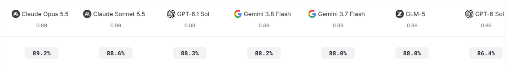
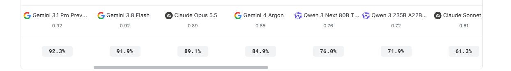
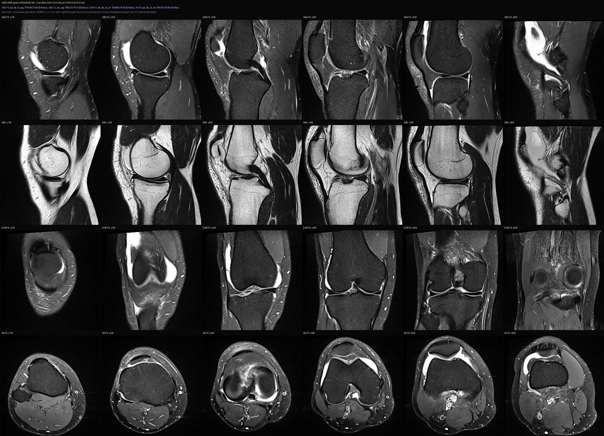

# RSNA Knee MRI reports — LLM label-extraction benchmark 

- **URL:** https://www.kaggle.com/competitions/rsna-knee-abnormality-detection/discussion/747658
- **Author:** **Kirderf** (@kirderf, Grandmaster) · _topic author_ · 2026-10-09 08:02 UTC · ▲20 · LB rank 663
- **Topic votes:** 20 · **Comments/replies:** 15 · **Pinned:** no
- **Last comment:** 2026-10-14 16:51 UTC by Kirderf
- **Cloned:** 2026-10-14 18:23 UTC (topic id 747658, raw JSON `_raw/747658.json`)

---

Trying the Kaggle Benchmark format -- work in progress --

https://www.kaggle.com/benchmarks/kirderf/rsna-knee-llm-label-extraction-benchmark

---

## Comments (15, threaded, oldest first)

### [1] hengck23

**hengck23** (@hengck23, Grandmaster) · 2026-10-09 10:20 UTC · ▲1 · LB rank 455

i have a wild experiment:  
1) lets define llm label and GT label (the golden 58)    
2) my multi mri image predictor trains very fast in hr.    
3) llm label is close to GT label. e.g. hamming distance per class is less than 3. some class are more likely to be wrong. some class has only FP but zero FN, etc ... in short, they are not random.   
4) assume we want to denoise the noisy 4300 study llm labels, we only allow minimal changes. it turns out that the number of pausible cleaned labels is small (maybe 100) and can be ranked  
5) we train mri models using most probable clean labels, measure auc performance on gold58 set, backed by public LB (5 per day).  
6) will brute force denoising gives good results?  

----

### [2] hengck23

**hengck23** (@hengck23, Grandmaster) · 2026-10-09 10:32 UTC · ▲3 · LB rank 455

note that the GT labels may be created by radiologist/doctors without looking at the report. Hence, the report and label are independent, and a discrepancy exists. That explains the upper limit of 0.90 in teh results.

#### ↳ [2.1] Kirderf

**Kirderf** (@kirderf, Grandmaster) · _topic author_ · 2026-10-09 10:41 UTC · LB rank 663

Thanks, great to underscore, I add to the information text.

##### ↳ ↳ [2.1.1] hengck23

**hengck23** (@hengck23, Grandmaster) · 2026-10-09 10:47 UTC · ▲2 · LB rank 455

check one of the 58 gold label stduy id:   
1.2.826.0.1.3680043.8.498.12606657226568558340797193167488111973  

label is "Effusion": 1,  

quote from medical report "No knee effusion is present."

##### ↳ ↳ [2.1.2] Kirderf

**Kirderf** (@kirderf, Grandmaster) · _topic author_ · 2026-10-09 11:42 UTC · LB rank 663

Yes working with image vs report is the objective, one of the experiments lately:
- Read every report several independent times.
- Fuse the readers into one probability per cell.
Combine the per-reader probabilities into a single fused probability per
(study, finding) cell — use a weighted mean over the reader pool.
Keep, per cell: the fused probability, the number of readers that
answered (__nsrc), their disagreement (__spread = max−min), and a
confidence (__conf).
- Find the cells most likely to be wrong.
- Re-read the actual report text per cell.
- Apply verdicts onto the fused table.
- Fill the silent cells with measured priors, not zero.

### [3] hengck23

**hengck23** (@hengck23, Grandmaster) · 2026-10-10 02:46 UTC · ▲1 · LB rank 455

for your reference, complete reproducible results for Claude4.5 (auc 0.891895) is found at: https://github.com/NTejas-1/RSNA-Knee-Abnormality-Detection. It has prompt, labels, etc.

Full credits go to the author @NTejas-1 and thanks for his hard work

### [4] (unknown)

**(unknown)** · 2026-10-13 13:21 UTC

_(no content — deleted or empty)_

### [5] Kirderf

**Kirderf** (@kirderf, Grandmaster) · _topic author_ · 2026-10-13 21:16 UTC · ▲7 · LB rank 663

Trying a vision LLM benchmark as well - Instead of feeding the radiology REPORT to an LLM, render each gold study's MRI to a single annotated mosaic JPEG and ask a vision LLM to score the same 12 findings directly from the images.

#### ↳ [5.1] Jack

**Jack** (@jackvd, Master) · 2026-10-13 22:27 UTC · ▲1 · LB rank 261

This is awesome!

#### ↳ [5.2] hengck23

**hengck23** (@hengck23, Grandmaster) · 2026-10-13 23:26 UTC · LB rank 455

thanks a lot! there is one medical MLLM that can take in 3d nii file directly: https://huggingface.co/ZJU-AI4H/Hulu-Med-14B.
check this work as well: https://github.com/lamawmouk/SGMRI-VQA

#### ↳ [5.3] Kirderf

**Kirderf** (@kirderf, Grandmaster) · _topic author_ · 2026-10-14 06:59 UTC · LB rank 663

Checking the logs and not all finished with the 58 golden studies, I'll create two new benchmarks, one that only pick out those finished with complete 58/58 results and one benchmark that use only 1 study, the hardest.

1 model(s): ['google/gemini-3.1-pro-preview']
vision single: 47/58 ok

1 model(s): ['google/gemini-3.8-flash']
vision single: 58/58 ok

1 model(s): ['google/gemini-4-argon']
vision single: 6/58 ok

1 model(s): ['anthropic/claude-opus-5-5@default']
vision single: 11/58 ok

1 model(s): ['openai/gpt-5.6-terra']
vision single: 2/58 ok

1 model(s): ['qwen/qwen3-next-80b-a3b-thinking']
vision single: 58/58 ok

1 model(s): ['openai/gpt-6-luna']
vision single: 58/58 ok

1 model(s): ['anthropic/claude-sonnet-5-5@default']
vision single: 58/58 ok

1 model(s): ['google/gemma-4-31b']
vision single: 58/58 ok

##### ↳ ↳ [5.3.1] Jack

**Jack** (@jackvd, Master) · 2026-10-14 13:23 UTC · LB rank 261

Could you share the 3.8 flash prompt and settings? I'd like to play around with this myself

#### ↳ [5.4] Kirderf

**Kirderf** (@kirderf, Grandmaster) · _topic author_ · 2026-10-14 07:11 UTC · LB rank 663

Also did a local test on kaggle 2xT4 + **qwen3-8-27b-swift-1-5-w4a16** no-think+768 tokens (minimal custom inference setup) on 10 studies

GOLD EVAL {'tag': 'native', 'macro_auc': 0.6064, 'n': 10, 'n_auc_labels': 12, 'ACL': 0.5, 'MCL': 0.9444, 'Medial Meniscus': 0.6905, 'Lateral Meniscus': 0.4583, 'Medial OA': 0.5938, 'Lateral OA': 0.6562, 'PF OA': 0.6, 'Effusion': 0.375, 'Synovitis': 0.625, "Baker's": 0.3333, 'Contusion': 0.5, 'Fracture': 1.0}
[eng] gold eval in 3571s -> gold_preds.csv | macro_auc=0.6064

##### ↳ ↳ [5.4.1] hengck23

**hengck23** (@hengck23, Grandmaster) · 2026-10-14 07:20 UTC · LB rank 455

on my local PC (unsloth  qwen3.8-27b) medical text: AUC 0.87

##### ↳ ↳ [5.4.2] Kirderf

**Kirderf** (@kirderf, Grandmaster) · _topic author_ · 2026-10-14 07:27 UTC · LB rank 663

The benchmark I did was on minimal settings, I'll try with more tokens, thinking and also the pure unsloth qwen3.8-27b, doing the testing with kaggle T4s and for it to work a custom inference setup.
