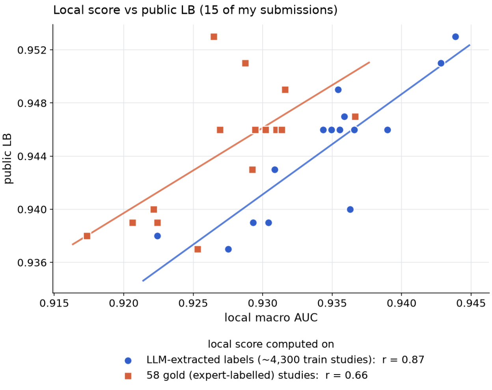

# Local CV or Public LB: which one can we trust?

- **URL:** https://www.kaggle.com/competitions/rsna-knee-abnormality-detection/discussion/748011
- **Author:** **colum2131** (@columbia2131, Master) · _topic author_ · 2026-10-10 08:37 UTC · ▲12 · LB rank 53
- **Topic votes:** 12 · **Comments/replies:** 8 · **Pinned:** no
- **Last comment:** 2026-10-13 11:25 UTC by varshitha kolupuri
- **Cloned:** 2026-10-14 18:23 UTC (topic id 748011, raw JSON `_raw/748011.json`)

---

In this competition, the only expert-labelled data available for local validation are the 58 gold training studies. That makes local validation unusually challenging.

I compared two local validation scores against the public LB across 15 of my own submissions, each based on five-fold CV:

* AUC on the 58 gold studies vs. public LB: r = 0.66.
* AUC on ~4,300 studies with LLM-extracted labels vs. public LB: r = 0.87.

For my submissions, higher CV scores on the LLM-extracted (weak) labels have generally gone hand in hand with higher public LB scores. AUC on the 58 gold studies tracked the public LB less closely.

My current thinking:

* The public LB uses ~30% of the test set, which is much larger than 58 studies. It may therefore provide a more reliable signal, though sample size alone doesn't guarantee that.
* For local validation, evaluating out-of-fold predictions against the LLM-extracted labels across the training set might be the most practical option after all.

I'd love to hear how others are approaching validation here, and whether you've seen similar patterns. I'm also curious how much of a leaderboard shake-up people expect at the end.

Slightly off-topic, but since the metric is AUC: submitting 1 − p instead of p gives you 1 − AUC on the public LB. Because the leaderboard only displays each team's best score, a team could use this to track improvements without revealing its actual performance, then flip the predictions back at the end.

So there may be some strong teams flying under the radar. It'll be interesting to watch the LB in the final days. 

([yu4u](https://www.kaggle.com/ren4yu) and [tattaka](https://www.kaggle.com/tattaka) did very well in past RSNA competitions, yet their team is sitting at just 0.949 on the public LB right now, which feels a little suspicious 👀)

---

## Comments (8, threaded, oldest first)

### [1] hengck23

**hengck23** (@hengck23, Grandmaster) · 2026-10-10 08:58 UTC · LB rank 455

submit classwise. you should see something

### [2] datnt114

**datnt114** (@kingkong153, Expert) · 2026-10-10 10:16 UTC · ▲2 · LB rank 30

for me, i trust cv local.

my best pb is 0.961 with oof (5 fold) 0.937 and god58: 0.938

#### ↳ [2.1] hengck23

**hengck23** (@hengck23, Grandmaster) · 2026-10-10 10:27 UTC · LB rank 455

Assume: (local cv + local train)/2 = (public lb + private lb)/2

### [3] Cody_Null

**Cody_Null** (@cody11null, Grandmaster) · 2026-10-10 14:55 UTC · ▲1 · LB rank 100

I think both tell a story but neither is trustworthy. Extracted labels are .9 at best which isnt terribly representative of the data. Then gold is representative but its so so small that it almost doesnt matter.

### [4] (unknown)

**(unknown)** · 2026-10-12 04:03 UTC · ▲-1

_(no content — deleted or empty)_

#### ↳ [4.1] D Chakraborty

**D Chakraborty** (@spoutop, Contributor) · 2026-10-12 04:35 UTC · ▲2 · LB rank 95

Copy questions to LLM -> generate answer and paste. Massive skill 👏 🤩

### [5] Cà Rốt Production

**Cà Rốt Production** (@crtproduction, Contributor) · 2026-10-12 08:02 UTC · LB rank 49

i want to say it depends on your OOF , your fold , the score will be different for everyone , for me up to the scorer , the most trustworthy judge will be the LB, we might be unable to know the test splitting data. but both OOF and gold tell something , some rules you must follow

### [6] varshitha kolupuri

**varshitha kolupuri** (@varshithakolupuri, Contributor) · 2026-10-13 11:25 UTC · ▲1 · LB rank 317

Two things I measured that might help here:

- **The public LB is noisier than it looks.** It scores ~30% of ~1,300 studies, about 390. Simulating macro AUC
  around 0.955 on 390 studies gives a standard deviation of roughly 0.003 for a single submission, so a
  0.001 public move between two very different models is mostly noise.
- **But the displayed score hides real differences.** Scores are truncated to 3 decimals, and inside a block of
  identical displayed scores the rank still follows the unrounded score. Adding one extra model kept my displayed
  score at 0.954 but moved my rank from 437 to 320, and later from 233 to 156 at 0.956. So for *paired*
  comparisons (same base, one change), rank movement inside the block is a finer signal than the 3-decimal score.

I made a notebook that shows the current tie blocks and the real score of every public notebook, if it is useful:
https://www.kaggle.com/code/varshithakolupuri/rsna-knee-real-scores-of-every-public-notebook
