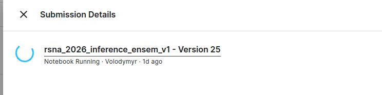

# Submission Stuck for Over 24 Hours

- **URL:** https://www.kaggle.com/competitions/rsna-knee-abnormality-detection/discussion/748403
- **Author:** **Volodymyr** (@vladimirsydor, Grandmaster) · _topic author_ · 2026-10-11 20:11 UTC · ▲1 · LB rank 159
- **Topic votes:** 1 · **Comments/replies:** 3 · **Pinned:** no
- **Last comment:** 2026-10-12 08:26 UTC by Volodymyr
- **Cloned:** 2026-10-14 18:23 UTC (topic id 748403, raw JSON `_raw/748403.json`)

---

Hi Kaggle Team!

One of our submissions has been stuck in a running state for over 24 hours. It seems to be a bug.

Could you please look into this and terminate the stuck submission?

Thanks in advance for your help!

FYI @macruzbar

---

## Comments (3, threaded, oldest first)

### [1] (unknown)

**(unknown)** · 2026-10-11 20:40 UTC

_(no content — deleted or empty)_

### [2] Danial Zakaria

**Danial Zakaria** (@nartaa, Expert) · 2026-10-11 21:01 UTC · LB rank 1098

From your screenshot, it doesn't seem it reached scoring, this looks like your notebook is stuck so you can just cancel it.

#### ↳ [2.1] Volodymyr

**Volodymyr** (@vladimirsydor, Grandmaster) · _topic author_ · 2026-10-12 08:26 UTC · LB rank 159

Unfortunately, it is not at the notebook execution level; it is already submitting. I can not cancel it
