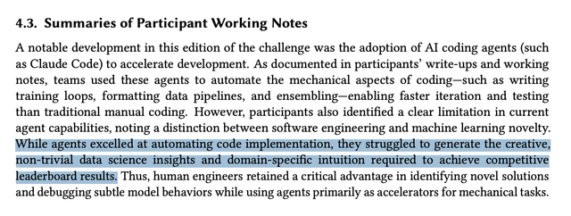

# How has AI helped your participation in the Knee Challenge? <10 minute survey

- **URL:** https://www.kaggle.com/competitions/rsna-knee-abnormality-detection/discussion/749038
- **Author:** **Po-Hao "Howard" Chen** (@javaduke95, Contributor) · _competition host_ · 2026-10-13 21:20 UTC · ▲3
- **Topic votes:** 3 · **Comments/replies:** 2 · **Pinned:** yes
- **Last comment:** 2026-10-13 23:58 UTC by Po-Hao "Howard" Chen
- **Cloned:** 2026-10-14 18:23 UTC (topic id 749038, raw JSON `_raw/749038.json`)

---

Hello Challengers

As a community, you have broken 100,000 submissions!  I could not have asked for a more enthusiastic group of AI builders who are committed to making better models to solve harder problems.

From RSNA's vantage point, we only see the Kaggle community once a year (it's how often we can find the money to fund these, and the people to curate the data), so we're genuinely curious about the role of AI in this year's challenge.

**If you joined this competition, we hope you would complete this <10 min survey here**: [https://forms.gle/mRFnAkyXL1o9MuVY8](https://forms.gle/mRFnAkyXL1o9MuVY8)

This is out of academic curiosity, and the data is collected anonymously.  And as such, your responses will not affect your leaderboard standing or eligibility to win.

---

## Comments (2, threaded, oldest first)

### [1] RB

**RB** (@rashmibanthia, Master) · 2026-10-13 23:19 UTC · LB rank 4

Something similar from [BirdClef+ 2026](https://www.kaggle.com/competitions/birdclef-2026)  participants - 

Paper:  [https://ceur-ws.org/Vol-4283/paper317.pdf](https://ceur-ws.org/Vol-4283/paper317.pdf)

#### ↳ [1.1] Po-Hao "Howard" Chen

**Po-Hao "Howard" Chen** (@javaduke95, Contributor) · _competition host_ · 2026-10-13 23:58 UTC · ▲1

Interesting paper. We radiology nerds spend so much time in this narrow domain I hadn't thought to look outside.  Thank you for sharing.  (And would appreciate your 5-10  mins filling out the survey too!)
